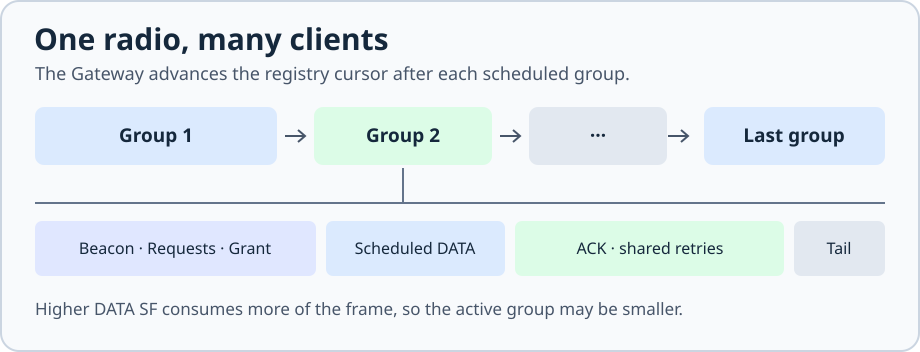
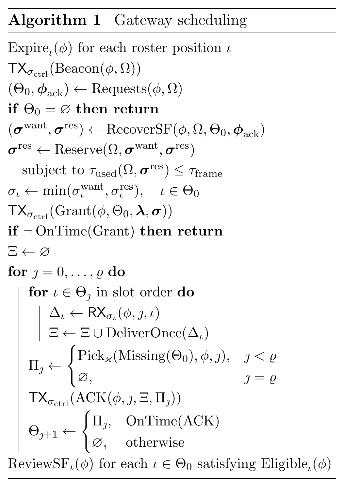

# Adaptive-LoRa

[简体中文](README.zh-CN.md)

**Research topic** — Reliability-aware TDMA scheduling and link adaptation for single-radio LoRa industrial energy monitoring networks. The project studies how delivery gaps and airtime change as one half-duplex Gateway serves more Clients with different link qualities.


<a name="flash-and-configure"></a>

[Flash and configure](docs/en/BENCH_RUNBOOK.md) · [Protocol and equations](docs/en/SCHEDULED_LINK.md) · [Results and research plan](docs/en/PROGRESS.md)


## How it works

The Gateway sends a Beacon at SF9. Clients request space for their payload and transmit only after a matching Grant. The Gateway sets DATA SF7–SF10 per Client, reserves slots for retries, and reports which packets it accepted through an ACK bitmap. The same radio switches between control and DATA phases. Bandwidth, coding rate, and requested TX power stay fixed.



The default wire-v5 profile serves a fixed roster of up to eight Clients. The opt-in wire-v7 candidate selects an airtime-feasible group from up to 128 registered IDs every 15 s. It signs Gateway control, authenticates Requests, and encrypts DATA with keys derived from each Client's credentials. The configured registry size tells you how many Clients can take turns. Delivery gaps depend on how often each Client can complete the exchange. [Wire v7 and capacity](docs/en/SCHEDULED_LINK.md#secure-wire-v7) · [Modeled delivery gaps](docs/en/PROGRESS.md#secure-rotation-experiment)

## Testing method

Use the same profile on the Gateway and every Client. Give each Client a unique ID and confirm the wire version in serial status.

- **Wire v5** generates a 32-byte sample for the fixed-roster test. [Flash and set roles](docs/en/BENCH_RUNBOOK.md#flash-and-set-roles)
- **Wire v7** requires per-board provisioning and matching schedule revisions. Update both roles to revision 2 and keep existing v7 credentials. Enable the sample generator for a radio test, or submit bytes through `FirmwareRuntime::submitPayload`. Check `APP_PAYLOAD` for received byte counts and capture DATA SF, ACKs, and retries. [Provision and test v7](docs/en/BENCH_RUNBOOK.md#test-the-secure-candidate)

## Airtime budget

```math
\begin{aligned}
\eta &= \eta_{\mathrm{header}} + \eta_{\mathrm{session}} + \eta_{\mathrm{tag}},\\
\tau_{\mathrm{slot},\iota}
  &= \tau_{\mathrm{air}}(\lambda_\iota+\eta,\sigma_\iota)+\delta,\\
\tau_{\mathrm{used}}
  &= \tau_{\mathrm{ctrl}}+\tau_{\mathrm{data}}
   +\varrho\,\tau_{\mathrm{retry}}+\tau_{\mathrm{tail}},\\
\tau_{\mathrm{used}} &\leq \tau_{\mathrm{frame}}.
\end{aligned}
```

Here $\lambda_\iota$ is the application payload size, $\sigma_\iota$ the DATA SF, and $\delta$ the slot guard. DATA overhead $\eta$ includes the header, session field, and, for v7, the authentication tag. $\tau_{\mathrm{ctrl}}$ includes each feedback window and uses the encoded control packet sizes for the selected profile. The retry pool reserves the longest eligible slots. [Airtime derivation](docs/en/SCHEDULED_LINK.md#airtime-and-slot-budget) · [Kalman estimator](docs/en/SCHEDULED_LINK.md#loss-cause-aware-adr)

## Gateway and Client algorithms

The listings show the shared schedule and the additional checks in wire v7. [LaTeX source](docs/research/figures/adaptive-algorithm.tex)

### Algorithm 1 (Gateway scheduling)



### Algorithm 2 (Client delivery)


## Q&A

**What is this for?** Low-rate telemetry with scheduled access on one LoRa radio. Energy monitoring is the research application. The protocol carries generic byte payloads.

**How do I integrate it into another system with AI?** Use the [integration prompt](docs/en/SCHEDULED_LINK.md#integration-prompt) to define your payload, acknowledgment semantics, timing, and tests before writing adapters.

Project-authored code is offered under [GPL-3.0-only](LICENSE). See [third-party terms and release obligations](THIRD_PARTY.md).
