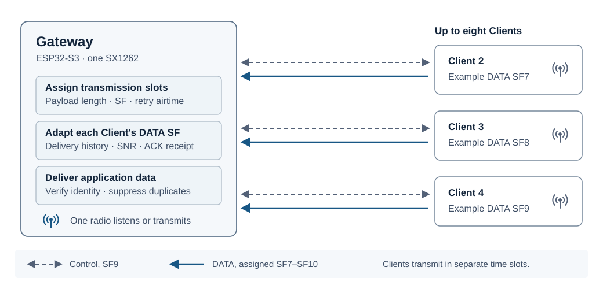

# Adaptive-LoRa

[简体中文](README.zh-CN.md)

Adaptive-LoRa is a research prototype for scheduled telemetry on one
half-duplex SX1262. The current test profile serves up to eight Clients.
The Gateway grants a DATA spreading factor (SF) per Client and limits
each new SF to the airtime available to the full roster.

**Eight-Client test.** Build the default `heltec_wifi_lora_32_V3_adaptive`
image for all nine boards. Verify wire version 5 after flashing. Use Gateway
ID 1 and Client IDs 2–9. Each Client queues a 32-byte ASCII sample such as
`ID=0002|SEQ=0001|MSG=HELLO WORLD`. The 15 s frame reserves that size
per Client. Check `APP_PAYLOAD` for `bytes=32` on the Gateway.

During a walk, read the top line on any page. `TX SF8 CR4/5` on the Client
identifies its last DATA attempt. The Gateway shows the last received DATA SF.
The Gateway adjusts DATA SF7–SF10 per Client, sizes slots to the requested
bytes and grants retries from the ACK bitmap. Control stays at SF9. Coding
rate, bandwidth, TX power and frame period stay fixed.

The Gateway tracks delivery separately for each Client. Two misses in
three eligible reports can start an airtime-checked trial at a higher
DATA SF, including when later ACK or retry timing is uncertain but the
primary receive window was observed. Each increase starts with a
temporary reservation. A matching ACK receipt in a valid Request
confirms it, and a failed trial releases the extra airtime. SNR helps
interpret packet loss. RSSI is logged for field diagnosis.
`SEARCH` means the Client is waiting for a fresh SF9 Beacon. `NO GRANT`
means its Request started but a matching Grant did not arrive.
The Gateway also has two [experimental SNR-margin rules](docs/en/SCHEDULED_LINK.md#loss-cause-aware-adr).

<a name="flash-and-configure"></a>

**[Flash, set roles and run the eight-Client test](docs/en/BENCH_RUNBOOK.md)** ·
[Protocol and equations](docs/en/SCHEDULED_LINK.md) ·
[Results and research references](docs/en/PROGRESS.md)



## How it works

Control uses $\sigma_{\mathrm{ctrl}}$ and each Client $\iota$ sends DATA at
$\sigma_\iota$. The Gateway fits the full roster $\Omega$ into the frame
budget, then uses $\Xi$ for accepted DATA and $\Pi_\jmath$ for retry slots
announced in round $\jmath$. A retry reuses the same packet $\Delta_\iota$.


[SF recovery and review pseudocode](docs/en/SCHEDULED_LINK.md#adaptation-and-recovery) ·
[LaTeX source](docs/research/figures/adaptive-algorithm.tex)

## Airtime budget

```math
\begin{aligned}
\tau_{\mathrm{slot},\iota}
  &= \tau_{\mathrm{air}}(\lambda_\iota+\eta,\sigma_\iota)+\delta,\\
\tau_{\mathrm{used}}
  &= \tau_{\mathrm{ctrl}}+\tau_{\mathrm{data}}
   +\varrho\,\tau_{\mathrm{retry}}+\tau_{\mathrm{tail}},\\
\tau_{\mathrm{used}} &\leq \tau_{\mathrm{frame}}.
\end{aligned}
```

Here $\lambda_\iota$ is the application payload, $\eta$ adds the frame
overhead, $\sigma_\iota$ is the selected SF, and $\delta$ is the guard time.
The retry term covers $\varrho$ rounds of the longest eligible slots.
The [derivation](docs/en/SCHEDULED_LINK.md#airtime-and-slot-budget) defines
each symbol, expands the control overhead and lists the settings used
by the current firmware.

With 32-byte samples and the other Clients at SF7, the 15 s model fits up
to five Clients at SF9 or two at SF10. The two-SF10 case leaves 77 ms beyond
the scheduled end reserve. Coverage and timing still need field measurements.
[Capacity and SF10](docs/en/SCHEDULED_LINK.md#sf10-capacity-and-higher-sf-options) ·
[Results and the 70-Client research plan](docs/en/PROGRESS.md)
