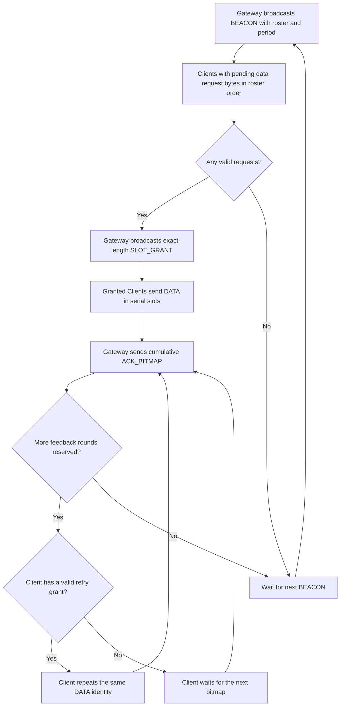

# Adaptive-LoRa

[简体中文](README.zh-CN.md)

Adaptive-LoRa is a scheduled LoRa P2P network for industrial sensing.
One Heltec ESP32-S3/SX1262 Gateway serves up to eight Clients on a single
half-duplex radio. All boards run the same firmware. The saved role and
node ID determine what each board does.

The research question is how to make delivery predictable when beacon,
DATA, and feedback all share one radio. The Gateway admits payloads by
their actual length, batches acknowledgements, and assigns retries to
Clients whose DATA is still missing. The current link uses a fixed PHY and
collects evidence for adaptive data rate (ADR) experiments.

| Setting | Value |
|---|---|
| Firmware / protocol | `0.2.0-alpha.1` / `3` |
| Default PlatformIO target | `heltec_wifi_lora_32_V3_multiclient` |
| Shipped roster | Gateway **1**, Clients **2–9**, network **1** |
| Application payload | Up to **64 bytes** per Client |
| Research PHY | **915.0 MHz** provisional, **SF7**, **BW125**, **CR 4/5** |
| Shipped superframe | **6.766 s**, sized for the full roster; **50 ms** experimental slot guard |

## How it works



Both roles anchor the schedule to radio completion timestamps. The Client
needs a current grant to transmit. If feedback is lost, it stays silent in
that retry round and can still be confirmed by a later cumulative bitmap.
After beacon expiry, the Client listens continuously for a new schedule.

## Research status

| Area | Implemented and verified | Open research or bench work |
|---|---|---|
| Synchronization and TDMA | DIO1 completion timestamps, exact-length grants, serialized slots. Production state machines tested with 1, 2, 4, and 8 simulated Clients. | Measure IRQ latency, TX launch, RX re-arm and clock drift on the boards. |
| Delivery and retries | Cumulative ACK bitmap and up to four shared slots per retry round. Host tests cover loss, duplicate suppression and reboot recovery. | Compare first-pass delivery and delivery after retries with a physical eight-Client roster. |
| Link adaptation | Per-Client reception evidence and an offline ADR evaluator with configurable thresholds and hysteresis. | Agree on versioned PHY changes, measure SX1262 retune time, and verify recovery under lost control messages. |
| Capacity | The shipped eight-Client roster fits the analytical calendar. | Larger rosters need different control frames and scheduling. |

The four papers inform different parts of the system. TS-VP-LoRa informs
payload-sized slots, LoRaHART informs aggregate feedback, ATS-LoRa informs
capacity budgeting, and Soy's work informs link adaptation experiments.
The [research map](docs/research/ALGORITHM_TRACEABILITY.md) links the
papers to the source and evidence. The [progress record](docs/en/PROGRESS.md)
lists the build and host results. A full nine-board RF trial is still pending.

## Flash and configure

Use Heltec WiFi LoRa 32 V3.4 boards with a suitable 50-ohm antenna or load
connected before power. A stored role can start radio traffic on boot.
For boards with an image or settings to preserve, follow the
[backup and RF bench procedure](docs/en/BENCH_RUNBOOK.md) before opening
a monitor or uploading. Use an authorized RF setup.

### 1. Upload the same build to each board

Open this repository in VS Code with PlatformIO, or run these commands
from the project root. Connect one board at a time with a USB-C data cable.
Use the COM port reported for that board and close any monitor before uploading.
If your shell cannot find `pio`, open the PlatformIO terminal in VS Code.

```powershell
pio device list
$port = 'COMx' # Replace with the observed port
pio run -e heltec_wifi_lora_32_V3_multiclient -t upload --upload-port $port
pio device monitor --port $port --baud 115200
```

In the VS Code sidebar, the equivalent is **PlatformIO → Project Tasks →
heltec_wifi_lora_32_V3_multiclient → General → Upload**, followed by **Monitor**.
Use a standard upload with the same partition layout to retain NVS. If no
board-specific COM port appears, follow the [USB checks](docs/en/BENCH_RUNBOOK.md#windows-device-manager).

### 2. Set the Gateway and Client roles

Send one command per line in the serial monitor. Keep the network ID and
Gateway ID the same across all boards. The first Client's node ID is **2**.
Use **3–9** for the remaining Clients, one unique ID per board.

**Gateway**

```text
config set role gateway
config set network-id 1
config set node-id 1
config set gateway-id 1
config set hello-interval-ms 3000
config show
config save
```

**First Client**

```text
config set role client
config set network-id 1
config set node-id 2
config set gateway-id 1
config set hello-interval-ms 3000
config show
config save
```

After `CONFIG_SAVED`, send `reboot`. Reconnect the monitor if needed, then
run `status`. Check the loaded role and IDs and look for `protocol=3` and
`profile=multiclient`. The Gateway reports `roster_count=8` and
`period_us=6766000`; the count is the roster size, even with one Client
present. The 3 s setting feeds the example payload source. The Gateway
calendar decides when the Client can send it.

### 3. Verify the link

Start with one Gateway and one Client. Look for `APP_PAYLOAD` on the Gateway
and `V3_PAYLOAD_RESULT` with `result=accepted` on the Client for the same
frame. Then test loss of Gateway power and recovery. Add Clients in stages
of 2, 4, and 8 once the pair passes. For packet counts, trace capture and
timing measurements, use the [bench procedure](docs/en/BENCH_RUNBOOK.md).

## Further reading

- [Protocol and slot calendar](docs/en/SCHEDULED_LINK.md)
- [Research references and implementation mapping](docs/research/ALGORITHM_TRACEABILITY.md)
- [Current evidence and open milestones](docs/en/PROGRESS.md)
