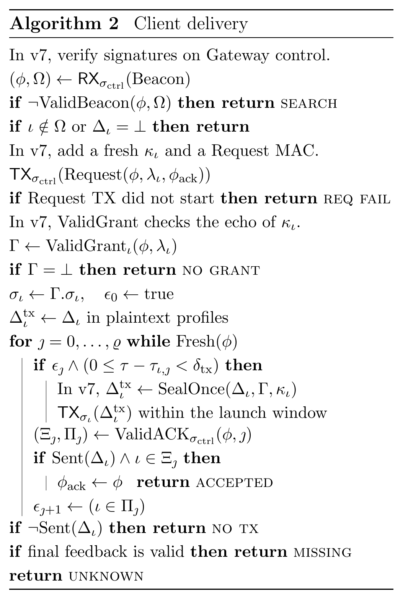

# Adaptive-LoRa

[简体中文](README.zh-CN.md)

**Research topic** — Reliability-aware TDMA scheduling and link adaptation for single-radio LoRa industrial energy monitoring networks.

**Theme and objective.** Study how a single half-duplex Gateway can share airtime among low-rate telemetry Clients with different link qualities. Measure delivery, time between service opportunities, and airtime as the population grows.


<a name="flash-and-configure"></a>

[Flash and configure](docs/en/BENCH_RUNBOOK.md) · [Protocol and equations](docs/en/SCHEDULED_LINK.md) · [Results and research plan](docs/en/PROGRESS.md)


## How it works

The Gateway sends a Beacon at SF9. Clients request space for their payload and transmit only after a matching Grant. The Gateway sets DATA SF7–SF10 per Client, reserves slots for retries, and reports which packets it accepted through an ACK bitmap. The same radio switches between control and DATA phases. Bandwidth, coding rate, and requested TX power stay fixed.


The default profile serves up to eight Clients. The wire-v7 candidate selects a group from up to 128 registered IDs every 15 s. It signs Gateway messages and encrypts DATA with a key unique to each Client. See the [secure protocol and capacity](docs/en/SCHEDULED_LINK.md#secure-wire-v7) and the [provisioning procedure](docs/en/BENCH_RUNBOOK.md#test-the-secure-candidate). Physical timing, coverage and recovery still need measurements.

## Testing method

Build the same image for every board and assign each Client a unique ID. Confirm the wire version in serial status before testing. The example sends a 32-byte sample. Look for `APP_PAYLOAD` on the Gateway and check received bytes, DATA SF, ACKs, and retries in the capture. The [setup guide](docs/en/BENCH_RUNBOOK.md#flash-and-set-roles) gives the commands for both roles.

## Airtime budget

```math
\begin{aligned}
\tau_{\mathrm{slot},\iota}
  &= \tau_{\mathrm{air}}(\lambda_\iota+\eta,\sigma_\iota)+\delta,\\
\tau_{\mathrm{used}}
  &= \tau_{\mathrm{ctrl}}+\tau_{\mathrm{data}}
   +\varrho\,\tau_{\mathrm{retry}}+\tau_{\mathrm{tail}},\\
\tau_{\mathrm{used}} &\leq \tau_{\mathrm{frame}}.
\end{aligned}
```

Here $\lambda_\iota$ is the payload size, $\eta$ the frame overhead, $\sigma_\iota$ the DATA SF, and $\delta$ the guard time. The retry pool reserves the longest eligible slots. See the [airtime derivation](docs/en/SCHEDULED_LINK.md#airtime-and-slot-budget) and [Kalman estimator](docs/en/SCHEDULED_LINK.md#loss-cause-aware-adr) for the assumptions and equations.

<details>
<summary>Gateway and Client pseudocode</summary>




[LaTeX source](docs/research/figures/adaptive-algorithm.tex)

</details>

## Q&A

**What is this for?** Low-rate telemetry with scheduled access on one LoRa radio. Energy monitoring is the research application. The protocol carries generic byte payloads.

**How do I integrate it into another system with AI?** Use the [integration prompt](docs/en/SCHEDULED_LINK.md#integration-prompt) to define your payload, acknowledgment semantics, timing, and tests before writing adapters.

Project-authored code is offered under [GPL-3.0-only](LICENSE). See [third-party terms and release obligations](THIRD_PARTY.md).
