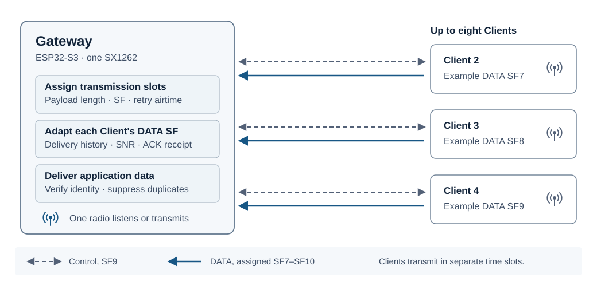
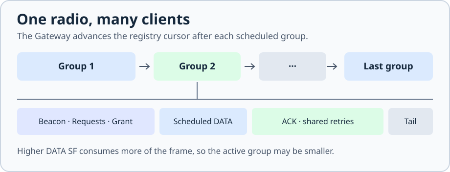
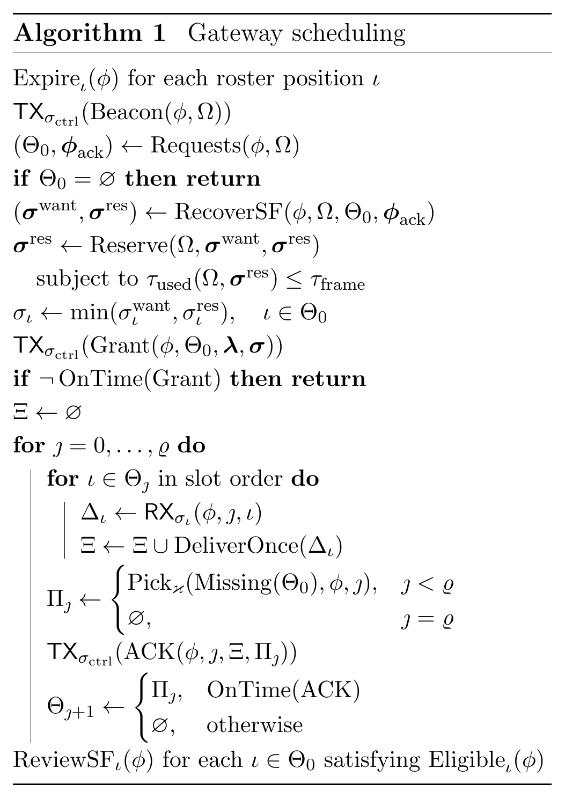
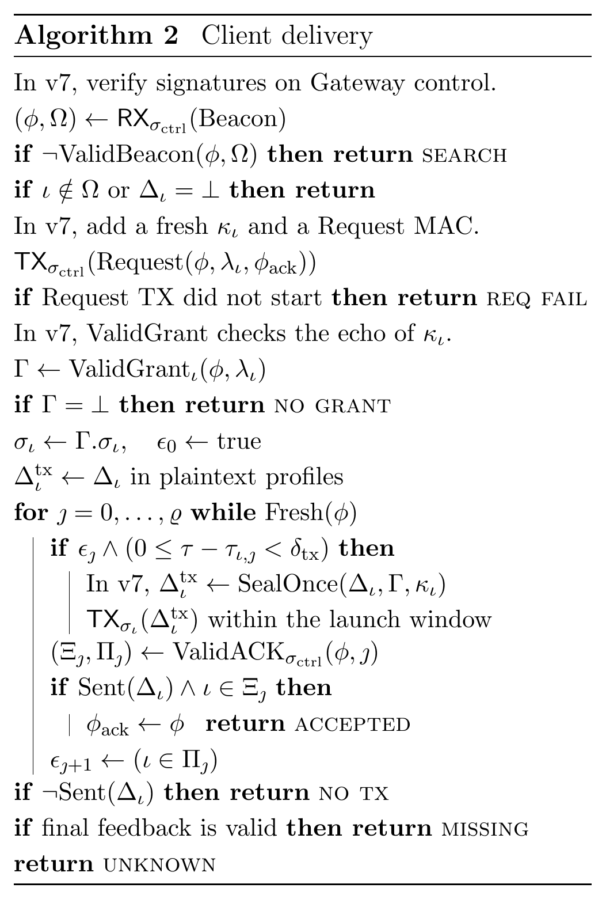

# Adaptive-LoRa

[English](README.md)

**研究题目**：面向单射频 LoRa 工业能源监测网络、考虑可靠性的 TDMA 调度与链路自适应。研究单台半双工网关服务更多链路条件各异的客户端时，交付间隔和空口占用如何变化。


<a name="烧录与配置"></a>

[烧录与配置](docs/zh-CN/BENCH_RUNBOOK.md) · [协议和公式](docs/zh-CN/SCHEDULED_LINK.md) · [结果与研究计划](docs/zh-CN/PROGRESS.md)



## 工作流程

网关在 SF9 广播信标。客户端申请有效载荷所需的时隙，收到匹配的授权后才发送。网关为每个客户端分配 DATA SF7–SF10，预留重试时隙，并通过 ACK 位图反馈已接收的报文。同一射频在控制阶段和 DATA 阶段之间切换。带宽、编码率和请求发射功率固定。



默认的空口 v5 配置使用固定名单，最多服务八个客户端。可选的空口 v7 候选版最多登记 128 个 ID，每个 15 秒帧选择一组符合空口预算的客户端。它对网关控制报文签名，验证 Request，并使用各客户端凭据派生的密钥加密 DATA。登记数量决定多少客户端可以轮流发送，实际交付间隔取决于各客户端完成报文交换的频率。[空口 v7 与容量](docs/zh-CN/SCHEDULED_LINK.md#secure-wire-v7) · [交付间隔模型](docs/zh-CN/PROGRESS.md#secure-rotation-experiment)

## 测试方法

网关与所有客户端使用同一配置。为各客户端分配唯一 ID，并在串口确认空口版本。

- **空口 v5** 为固定名单测试生成 32 字节样本。[烧录与设置角色](docs/zh-CN/BENCH_RUNBOOK.md#flash-and-set-roles)
- **空口 v7** 需要逐板配置凭据并使用相同调度修订版。两种角色须同时更新到修订版 2，可沿用已有 v7 凭据。链路测试可启用样本生成器，也可通过 `FirmwareRuntime::submitPayload` 提交数据。在网关查看 `APP_PAYLOAD` 的接收字节数，记录 DATA SF、ACK 和重试。[配置并测试 v7](docs/zh-CN/BENCH_RUNBOOK.md#test-the-secure-candidate)

## 空口时间预算

```math
\begin{aligned}
\eta &= \eta_{\mathrm{header}} + \eta_{\mathrm{session}} + \eta_{\mathrm{tag}},\\
\tau_{\mathrm{slot},\iota}
  &= \tau_{\mathrm{air}}(\lambda_\iota+\eta,\sigma_\iota)+\delta,\\
\tau_{\mathrm{used}}
  &= \tau_{\mathrm{ctrl}}+\tau_{\mathrm{data}}
   +\varrho\,\tau_{\mathrm{retry}}+\tau_{\mathrm{tail}},\\
\tau_{\mathrm{used}} &\leq \tau_{\mathrm{frame}}.
\end{aligned}
```

其中 $\lambda_\iota$ 为应用载荷大小，$\sigma_\iota$ 为 DATA SF，$\delta$ 为时隙保护时间。DATA 开销 $\eta$ 包括帧头、会话字段及 v7 的认证标签。$\tau_{\mathrm{ctrl}}$ 包含所有反馈窗口，并按所选配置的实际控制帧长度计算。重试池为最长的可用时隙预留时间。[空口时间推导](docs/zh-CN/SCHEDULED_LINK.md#airtime-and-slot-budget) · [卡尔曼估计器](docs/zh-CN/SCHEDULED_LINK.md#loss-cause-aware-adr)

## 网关与客户端算法

下列算法展示通用调度流程以及空口 v7 增加的检查。[LaTeX 源文件](docs/research/figures/adaptive-algorithm.tex)

<a name="algorithm-1-gateway-scheduling"></a>

### 算法 1（网关调度）



<a name="algorithm-2-client-delivery"></a>

### 算法 2（客户端交付）



## 常见问题

**这个项目用来做什么？** 在单个 LoRa 射频上为低速遥测安排传输时隙。研究面向能源监测，协议承载通用字节数据。

**怎样借助 AI 接入其他系统？** 使用[集成提示词](docs/zh-CN/SCHEDULED_LINK.md#integration-prompt)，先明确载荷、确认语义、时序和测试，再编写适配层。

项目原创代码采用 [GPL-3.0-only](LICENSE)。参见[第三方条款和发布义务](THIRD_PARTY.md)。
