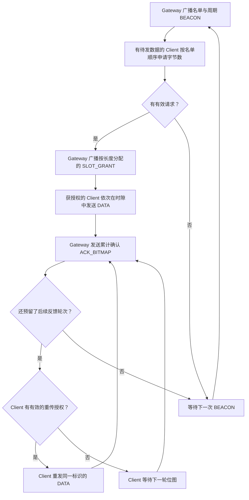

# Adaptive-LoRa

[English](README.md)

Adaptive-LoRa 是面向工业传感的定时 LoRa P2P 网络。一个 Heltec ESP32-S3/SX1262
Gateway 使用单个半双工收发器，最多服务八个 Client。所有板卡运行同一固件，角色和节点
ID 由已保存的配置决定。

项目研究如何在信标、DATA 和反馈共用一个收发器的条件下提高交付的可预期性。
Gateway 按实际载荷长度分配时隙，汇总确认，并为仍缺少 DATA 的 Client 分配重传机会。
目前链路使用固定 PHY，同时采集自适应数据率（ADR）实验所需的链路数据。

| 设置 | 值 |
|---|---|
| 固件 / 协议 | `0.2.0-alpha.1` / `3` |
| 默认 PlatformIO 目标 | `heltec_wifi_lora_32_V3_multiclient` |
| 默认名单 | Gateway **1**，Client **2–9**，网络 **1** |
| 应用载荷 | 每个 Client 最多 **64 字节** |
| 研究 PHY | 暂定 **915.0 MHz**、**SF7**、**BW125**、**CR 4/5** |
| 默认超帧 | **6.766 s**，按完整名单预留；时隙保护间隔暂定 **50 ms** |

## 工作流程



两端以无线完成事件的时间戳作为时序锚点。Client 要有当帧授权才能发射。若丢失反馈，
本轮保持静默，后续累计位图仍可确认此前的交付。信标过期后，Client 持续接收以重新获取调度。

## 研究进展

| 方向 | 已实现与验证 | 待研究或实测 |
|---|---|---|
| 同步与 TDMA | DIO1 完成时间戳、按长度授权和串行时隙；实际状态机已在主机上模拟 1、2、4、8 个 Client。 | 实测 IRQ 时延、启动发送、恢复接收和时钟漂移。 |
| 交付与重传 | 累计 ACK 位图，每轮重传至多四个共享时隙。主机测试覆盖丢包、去重和重启恢复。 | 比较八个实物 Client 的首轮交付率及重传后交付率。 |
| 链路自适应 | 按 Client 记录接收结果；离线 ADR 工具支持自定义阈值和滞回。 | 设计带版本的 PHY 切换协商、测量 SX1262 切换耗时，并验证控制帧丢失后的恢复。 |
| 容量 | 默认八个 Client 的名单通过时序预算计算。 | 更大规模需要新的控制帧和调度设计。 |

四篇论文分别为不同机制提供依据。TS-VP-LoRa 对应按载荷分配时隙；LoRaHART 对应
汇总反馈；ATS-LoRa 对应容量预算；Soy 的研究对应链路自适应实验。
[研究映射](docs/research/ALGORITHM_TRACEABILITY.md) 关联论文、代码与验证证据。
[进度记录](docs/zh-CN/PROGRESS.md) 提供构建和主机测试结果。九板射频试验仍待完成。

## 烧录与配置

使用 Heltec WiFi LoRa 32 V3.4，上电前接入合适的 50 欧姆天线或负载。已保存角色的
板卡可能在启动后发射。若需要保留现有镜像或配置，请先按
[备份与射频台架流程](docs/zh-CN/BENCH_RUNBOOK.md) 操作，再打开串口或上传。使用获准的射频设置。

### 1. 向各板卡上传同一固件

在 VS Code 的 PlatformIO 中打开本仓库，或在项目根目录运行以下命令。
用可传数据的 USB-C 线每次连接一块板。确认实际 COM 端口，关闭已打开的串口监视器后再上传。
若终端找不到 `pio`，请使用 VS Code 的 PlatformIO 终端。

```powershell
pio device list
$port = 'COMx' # 换成观测到的端口
pio run -e heltec_wifi_lora_32_V3_multiclient -t upload --upload-port $port
pio device monitor --port $port --baud 115200
```

在 VS Code 侧栏可依次选择 **PlatformIO → Project Tasks →
heltec_wifi_lora_32_V3_multiclient → General → Upload**，再打开 **Monitor**。
使用相同分区布局的常规上传以保留 NVS。若没有板卡对应的 COM 端口，按
[USB 排查步骤](docs/zh-CN/BENCH_RUNBOOK.md#windows-设备管理器) 检查。

### 2. 设置 Gateway 和 Client 角色

在串口监视器中逐行发送命令。所有板卡使用相同的网络 ID 和 Gateway ID。
第一个 Client 的 node ID 为 **2**，其余 Client 各用一个不同的 **3–9**。

**Gateway**

```text
config set role gateway
config set network-id 1
config set node-id 1
config set gateway-id 1
config set hello-interval-ms 3000
config show
config save
```

**第一个 Client**

```text
config set role client
config set network-id 1
config set node-id 2
config set gateway-id 1
config set hello-interval-ms 3000
config show
config save
```

收到 `CONFIG_SAVED` 后发送 `reboot`。必要时重连串口，再执行 `status`，核对已加载
的角色、ID、`protocol=3` 和 `profile=multiclient`。Gateway 报告
`roster_count=8` 和 `period_us=6766000`。即使只有一块 Client 在线，数量仍是名单
容量。3 s 设置用于产生示例载荷，实际发送时机由 Gateway 的调度决定。

### 3. 验证链路

先用一个 Gateway 和一个 Client。对同一帧，确认 Gateway 输出 `APP_PAYLOAD`，
Client 输出 `V3_PAYLOAD_RESULT` 且 `result=accepted`。再测试 Gateway 断电与恢复。
双板通过后，逐步增加至 2、4、8 个 Client。包数、日志采集和时序测量见
[台架流程](docs/zh-CN/BENCH_RUNBOOK.md)。

## 延伸阅读

- [协议与时隙调度](docs/zh-CN/SCHEDULED_LINK.md)
- [研究文献与代码映射](docs/research/ALGORITHM_TRACEABILITY.md)
- [当前证据与待完成的里程碑](docs/zh-CN/PROGRESS.md)
