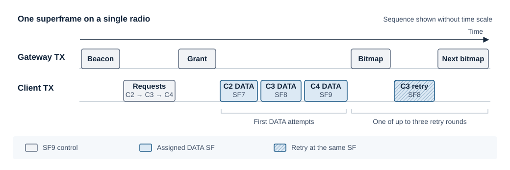

# Protocol and equations

[Home](../../README.md) · [Setup and field test](BENCH_RUNBOOK.md) · [Results](PROGRESS.md) · [简体中文](../zh-CN/SCHEDULED_LINK.md)

## Wire format



Protocol 5 uses little-endian fields in a 28-byte header and a 96-byte
maximum frame. The header carries the network, source, destination,
sender boot ID, frame ID, sequence and schedule version. The Gateway
sends control frames to the group. Requests and DATA go to the Gateway.

| Frame | Sender | Body after the header |
|---|---|---|
| Beacon | Gateway | Period in µs (u32), roster count (u8), then node ID (u16) and byte limit (u8) per Client |
| Request | Client | Gateway boot ID (u32), requested bytes (u8), last ACKed frame in this session (u32, zero if absent) |
| Grant | Gateway | Count (u8), then granted bytes (u8), Client boot ID (u32) and DATA SF (u8) per entry |
| DATA | Client | Gateway boot ID (u32), then the granted application bytes |
| ACK bitmap | Gateway | Count, accepted mask and retry mask (u8 each), then one u32 Client boot ID per position. Unaccepted entries carry zero. |

Empty Grant entries carry length `0xFF` and zero boot ID and SF. The
codec checks length, wire version, network, destination, and payload
shape. The runtime also checks the current frame, the expected session
IDs, the Grant and the receive window. Control uses a shared SF. DATA
uses the granted SF for both its first transmission and retries. Upgrade
the Gateway and every Client together. An older adaptive decoder rejects
an entire Grant containing SF10, so the version byte prevents mixed
deployments from joining the same schedule.

## Airtime and slot budget

$\lambda$ counts all bytes presented to the LoRa modem before its PHY
header and CRC. $\sigma$ is the spreading factor and $\beta$ is the channel
bandwidth in Hz. The following symbol count includes the modulation
overhead and coding groups. [Semtech LoRa Calculator](https://www.semtech.com/design-support/lora-calculator)

```math
\begin{aligned}
\tau_{\mathrm{sym}}(\sigma)&=\frac{2^\sigma}{\beta},\\
\nu_{\mathrm{coded}}(\lambda,\sigma)
  &=\max\!\left(0,\left\lceil
     \frac{\kappa\lambda-\alpha\sigma+\zeta_0+
        \zeta_{\mathrm{CRC}}\iota_{\mathrm{CRC}}-
        \zeta_{\mathrm{IH}}\iota_{\mathrm{IH}}}
      {\alpha(\sigma-\mu\iota_{\mathrm{DE}})}
     \right\rceil\right).
\end{aligned}
```

```math
\begin{aligned}
\nu_{\mathrm{sym}}(\lambda,\sigma)
  &= \pi+\psi+\xi+\gamma\nu_{\mathrm{coded}}(\lambda,\sigma),\\
\tau_{\mathrm{air}}(\lambda,\sigma)
  &= \nu_{\mathrm{sym}}(\lambda,\sigma)\,\tau_{\mathrm{sym}}(\sigma).
\end{aligned}
```

| Symbol | Meaning | Current profile or formula coefficient |
|---|---|---|
| $\kappa$, $\alpha$, $\mu$ | Bits per byte, SF coefficient, LDRO denominator penalty | 8, 4, 2 |
| $\zeta_0$, $\zeta_{\mathrm{CRC}}$, $\zeta_{\mathrm{IH}}$ | Baseline, CRC and implicit-header terms in the symbol numerator | 28, 16, 20 |
| $\iota_{\mathrm{CRC}}$, $\iota_{\mathrm{IH}}$, $\iota_{\mathrm{DE}}$ | Flags for PHY CRC, implicit header and low-data-rate optimization | 1, 0, 0 for this SF range |
| $\pi$, $\psi$, $\xi$ | Programmed preamble symbols, fixed synchronization suffix, baseline payload symbols | 8, 4.25, 8 |
| $\gamma$ | Symbols per coding group, the denominator of the LoRa coding rate | 5 for CR 4/5 |
| $\beta$, $\sigma_{\mathrm{ctrl}}$, $\sigma_\iota$ | Bandwidth, common control SF, per-Client DATA SF | 125 kHz, SF9, SF7–SF10 |

$\Omega$ is the advertised roster and $\nu_\Omega=|\Omega|$ includes idle
Clients with Request windows. Use $\Theta=\Omega$ and each payload ceiling
$\lambda_\iota$ when reserving airtime. For the active schedule, $\Theta$
contains only granted Clients and $\lambda_\iota$ is the granted length.
$\Theta^\star$ contains up to $\varkappa$ of the longest slots in $\Theta$.

```math
\begin{aligned}
\eta &= \eta_{\mathrm{header}}+\eta_{\mathrm{session}},\\
\tau_{\mathrm{slot},\iota}
   &=\tau_{\mathrm{air}}(\lambda_\iota+\eta,\sigma_\iota)+\delta,\\
\tau_{\mathrm{data}}&=\sum_{\iota\in\Theta}\tau_{\mathrm{slot},\iota},\\
\tau_{\mathrm{retry}}&=\sum_{\iota\in\Theta^\star}\tau_{\mathrm{slot},\iota}.
\end{aligned}
```

```math
\begin{aligned}
\tau_{\mathrm{requests}} &= \delta+\nu_\Omega(\tau_{\mathrm{R}}+\delta)+\delta,\\
\tau_{\mathrm{bitmaps}} &= (\varrho+1)\tau_{\mathrm{A}} + \delta_{\mathrm{first}}
    +\varrho(\delta_{\mathrm{before}}+\delta_{\mathrm{after}})\\
    &\quad+\delta_{\mathrm{last}}+\delta_{\mathrm{close}},\\
\tau_{\mathrm{ctrl}} &= \tau_{\mathrm{B}}+\tau_{\mathrm{requests}}
    +\tau_{\mathrm{G}}+\tau_{\mathrm{bitmaps}}.
\end{aligned}
```

```math
\tau_{\mathrm{ctrl}}+\tau_{\mathrm{data}}+
\varrho\,\tau_{\mathrm{retry}}+\tau_{\mathrm{tail}}
\le \tau_{\mathrm{frame}}.
```

$\tau_{\mathrm{B}}$, $\tau_{\mathrm{R}}$, $\tau_{\mathrm{G}}$ and
$\tau_{\mathrm{A}}$ are the airtimes of one Beacon, Request, Grant and
bitmap at $\sigma_{\mathrm{ctrl}}$. Their encoded lengths come from the
wire table plus the common header. $\tau_{\mathrm{requests}}$ includes
the Request windows and the gaps before those windows and the Grant.
$\tau_{\mathrm{bitmaps}}$ covers all feedback frames, the gap before the
first DATA round, the gaps around the retry rounds, the gap before
the final bitmap and the closing guard. Each of these gaps uses $\delta$.
The Gateway uses the inequality before accepting a higher-SF
reservation. Lower-SF trials retain the previous reservation.

| Symbol | Meaning | Current adaptive image |
|---|---|---|
| $\eta_{\mathrm{header}}$, $\eta_{\mathrm{session}}$ | Frame header and Gateway boot ID in DATA | 28 B, 4 B |
| $\nu_\Omega$, $\lambda_\iota$ | Bench roster and per-Client payload ceiling | 8 Clients, 32 B. The wire format allows 64 B. |
| $\varrho$, $\varkappa$ | Retry rounds and shared retry slots per round | 3 rounds, up to 4 slots |
| $\delta$, $\tau_{\mathrm{tail}}$, $\tau_{\mathrm{frame}}$ | Slot guard, end reserve, superframe period | 80 ms, 300 ms, 15 s |

The retune lead and transmit launch window are one quarter of the guard.
The receive window is half a guard on either side of the expected packet
completion. The implementation measures from packet-completion
timestamps. It skips a transmit slot if software reaches it too late.
Physical retune time and drift still need measurement.
[Radio settings](../../include/radio_config.h) ·
[Airtime and sizes](../../src/common/protocol/multiclient_protocol.h) ·
[Slot scheduling](../../src/common/protocol/multiclient_protocol.cpp)

### Capacity at 15 seconds

For equal payload ceilings $\lambda_\mathrm{cap}$, place $\nu'$ Clients at
SF9 and the rest at SF7. The maximum number of SF9 reservations is

```math
\nu_9^{\max}=\max\!\left\{\nu'\in\{0,\ldots,\nu_\Omega\}\;\middle|\;
\tau_{\mathrm{used}}(\Omega,\lambda_{\mathrm{cap}},\boldsymbol{\sigma}(\nu'))
\le\tau_{\mathrm{frame}}\right\}.
```

| Clients | 16 B | 24 B | 32 B | 64 B |
|---:|---:|---:|---:|---:|
| 4 | 4 | 4 | 4 | 4 |
| 6 | 6 | 6 | 6 | 3 |
| 8 | 8 | 8 | 5 | 2 |

The adaptive sample carries 32 B of ASCII (256 bits). With the 28 B frame
header and 4 B Gateway boot ID, DATA is 64 B before LoRa PHY overhead.
Five SF9 Clients and three SF7 Clients reserve 14.905952 s. Eight at SF9
would need 15.722336 s. With all eight requesting, Beacon, Grant and four
ACKs account for 2.361344 s of Gateway transmission. Requests and control
gaps bring the control portion to 6.019456 s. These are computed durations.
[Bench ceiling](../../include/research_roster.h) · [Capacity model](../../tools/model_multiclient.py)

For a fixed roster, both the sum of DATA slots and the sum of the longest
retry slots are nondecreasing in each slot length. A Grant uses at most
the reserved payload and SF per Client, so its modeled time is bounded by
the checked roster reservation. Physical turnaround and clock error still
have to fit the guards.

### SF10 capacity and higher SF options

Eight Clients, 32 B each, SF9 control, four cumulative ACKs
and the full retry reservation. The second numeric column puts one Client at
the listed SF with seven at SF7. The last column gives the maximum number at
that SF when every other Client uses SF7. Times are modeled seconds.

| DATA SF | One 64 B DATA packet (s) | Frame headroom with one (s) | Maximum at this SF |
|---|---:|---:|---:|
| SF7 | 0.118 | 4.720 | 8 |
| SF8 | 0.216 | 4.330 | 8 |
| SF9 | 0.390 | 3.632 | 5 |
| SF10 | 0.698 | 2.399 | 2 |
| SF11 | 1.561 | -1.050 | 0 |
| SF12 | 2.793 | -5.982 | 0 |

With six peers at SF7, two SF10 reservations leave 77.408 ms beyond the
end reserve. A third SF10 exceeds the frame by 2.244 s. The Gateway
checks the current SF reservations and rejects increases that exceed the budget.

Keep control at SF9 for this roster. Switching just the control PHY to
SF10 would add 3.721 s to the modeled eight-Client frame, including
eight Requests and four ACK bitmaps. At 32 B and 15 s it would fit
at most two DATA SF8 Clients alongside SF7 peers. Even one DATA SF9
Client would exceed the frame by 89.504 ms. Gateway control TX alone
would rise from 2.361 s to 4.272 s per frame.

The radio sends Beacon, Request, Grant and ACK bitmaps at SF9. Both ends
retune to the granted SF for a DATA slot. The Client returns to SF9 for
feedback and the Gateway uses each next Client's SF before returning to
SF9. If control reception is lost, the Client waits for a new valid Beacon
and Grant. A higher DATA SF extends only the DATA link.

SF10 gives 8.192 ms per symbol at BW125 and uses no LDRO. Even a 96 B
packet at SF10 takes 0.985088 s, within the 2 s driver deadline. SF11 and
SF12 are model-only rows. They need LDRO, and the 96 B SF11 packet and the
64 B SF12 packet each exceed the current TX deadline.
[RadioLib SF limits](https://github.com/jgromes/RadioLib/blob/7.8.1/src/modules/SX126x/SX126x_config.cpp) ·
[RadioLib LDRO selection](https://github.com/jgromes/RadioLib/blob/7.8.1/src/modules/SX126x/SX126x_commands.cpp)

## Adaptation and recovery

The figure shows the shared SF policy and the three build-time rules.


In the README algorithms, $\phi$ is the frame ID, $\phi_{\mathrm{ack}}$ is
the last ACKed frame in the same Gateway session, and $\Gamma$ is a valid
Grant. Round $\jmath=0$ is the first DATA attempt. $\Theta_\jmath$ is the set
of authorized Clients, $\Xi$ accumulates accepted Clients, and $\Pi_\jmath$
selects up to $\varkappa$ granted Clients whose DATA has yet to arrive.
$\epsilon_\jmath$ records the local Client's permission to send. An invalid
or absent bitmap provides empty sets. The Gateway checks frame and session
identity, declared payload length, and timing before accepting DATA.

For current time $\tau$, scheduled TX start $\tau_{\iota,\jmath}$, expected
packet completion $\widehat{\tau}$ and observed completion $\tau_{\mathrm{rx}}$,
the windows and the SNR update are

```math
\begin{aligned}
0 &\le \tau-\tau_{\iota,\jmath}<\delta_{\mathrm{tx}},\\
-\delta_{\mathrm{rx}} &\le \tau_{\mathrm{rx}}-\widehat{\tau}<\delta_{\mathrm{rx}},\\
\overline{\upsilon}_\iota^{\mathrm{next}}
   &=(1-\omega)\overline{\upsilon}_\iota+\omega\upsilon_\iota.
\end{aligned}
```

This profile uses $\delta_{\mathrm{tx}}=\delta/4$, $\delta_{\mathrm{rx}}=\delta/2$
and $\omega=1/4$. The first finite first-attempt SNR sample $\upsilon_\iota$
at the current SF initializes the filter. The reserved SF can stay above
the requested SF during a lower-SF trial, preserving room to roll back.

The SF policy uses the following quantities. Frame IDs and ACK receipts
refer to the active Gateway session.

| Symbol | Meaning | Current value |
|---|---|---:|
| $\nu_{\mathrm{obs}}$, $\nu_{\mathrm{up}}$ | Size of the eligible-report window and misses needed to request an increase | 3, 2 |
| $\nu_{\mathrm{idle}}$ | Frame-ID gap that frees a higher-SF reservation | 4 |
| $\nu_{\mathrm{lock}}$, $\nu_{\mathrm{probe}}$ | First-attempt deliveries required to lock or consider a lower SF | 3, 6 |
| $\nu_{\mathrm{ack}}$, $\nu_{\mathrm{hold}}$ | Trial deadline and failed recovery cooldown in frame IDs, and first-attempt deliveries in the downshift hold | 6, 8 |

$\epsilon_\iota^{\mathrm{fail}}$ marks a missed first attempt, including a
retry that eventually delivered. $\alpha_\iota$ means the latest Request
echoes the stored delivery's frame and confirms its SF.
$\nu_\iota^{\mathrm{first}}$ counts the current run of first-attempt
deliveries, including the current eligible report. $\phi_\iota^{\mathrm{req}}$
and $\phi_\iota^{\mathrm{del}}$ are the last Request and delivery.
$\sigma_\iota^{\mathrm{del}}$ is the SF used for that delivery. The SF
state carries desired, reserved, remembered and rollback values
$\sigma_\iota^{\mathrm{want}}$, $\sigma_\iota^{\mathrm{res}}$,
$\sigma_\iota^{\mathrm{mem}}$ and $\sigma_\iota^{\mathrm{back}}$.
$h_\iota$ counts the remaining hold after rollback. $\theta_{\sigma_\iota-1}$
is the delivery-window rule's SNR threshold for trying the next lower SF.

Let $r_\sigma=x_{\mathrm{req}}+b_\sigma-\vartheta_\sigma$ be the
current Request margin at the assigned DATA SF $\sigma$. The loss indicator
$e$ is one if a same-SF retry delivers, or if no DATA arrives and a finite
Request sample gives $r_\sigma<M_{\mathrm{up}}$. It is zero with only
primary-slot evidence. All rules also track a separate window
$\boldsymbol{\chi}_\iota$ at the assigned SF. In the pseudocode,
$q_\iota$ means the primary receive window is usable, and $m_\iota=1$
means there is also no accepted DATA. An eligible accepted DATA report
contributes zero. Absence,
application refusal, and an unobserved or faulty primary slot do not
enter this window.

```math
\begin{aligned}
\boldsymbol{\xi}^{\mathrm{loss}}_\iota
  &\gets \mathrm{Tail}_{\nu_{\mathrm{obs}}}
  \bigl(\boldsymbol{\xi}^{\mathrm{loss}}_\iota\mathbin{\|}e\bigr),
  & e=1 &\;\land\; \sum_j\xi^{\mathrm{loss}}_{\iota,j}\ge\nu_{\mathrm{up}},\\
\boldsymbol{\chi}_\iota
  &\gets \mathrm{Tail}_{\nu_{\mathrm{obs}}}
  \bigl(\boldsymbol{\chi}_\iota\mathbin{\|}m_\iota\bigr),
  & m_\iota=1 &\;\land\; \sum_j\chi_{\iota,j}\ge\nu_{\mathrm{up}}.
\end{aligned}
```

The first row gives the normal delivery-window rule. The second row can
request an increase when the normal rule holds. Either trigger starts
the same deadline-bound trial. The next Grant checks the full roster
reservation. A primary miss with no accepted DATA at an admitted
candidate advances the search one step. After a delivery, a validated
Request confirms the trial when its receipt matches DATA accepted at
the candidate SF since the trial began. Confirmation happens during
Request processing and survives a later frame timing fault.
The search rolls back on budget denial, loss at the maximum SF, or
receipt expiry, releasing any additional reservation. Another search
can begin at $\phi-\phi_{\mathrm{failed}}\ge\nu_{\mathrm{ack}}$.
With a 15 s period, two successive eligible misses give a nominal
30 s from the first missed frame to the first higher-SF opportunity.
One intervening delivery within the window adds one frame. The clock for
receipt expiry runs even if later reports are unavailable.

A lock requires three first-slot deliveries and an ACK receipt at the same
SF, including when the budget limits a Grant to a lower SF. It stores the
confirmed SF and releases any higher reservation held for rollback. After
lock and hold expiry, six first-slot deliveries and enough filtered SNR
can open a lower-SF trial
(at least −3.5 dB for SF7, −6 dB for SF8 or −8.5 dB for SF9). A degraded
trial rolls back. A trial requested in frame $\phi_{\mathrm{probe}}$
also rolls back at age $\phi-\phi_{\mathrm{probe}}\geq\nu_{\mathrm{ack}}$
on a reviewed report with no matching receipt. At the start of the next
frame, an unconfirmed trial expires even if its reports were absent or
excluded. With a 15 s frame, six frame IDs correspond to 90 s. Either
rollback delays the next lower-SF trial for eight first-slot deliveries.

A Client retries only when a valid bitmap grants a retry. The Gateway
opens those slots after an in-window TX completion serviced before the
next DATA round. Later cumulative feedback can acknowledge an earlier
delivery after an ACK loss. All four bitmaps are retained. For each
Client, the Gateway checks whether RX was armed at the assigned SF
before the primary slot and whether a local radio failure invalidated
that window. An ACK or retry timing fault, or a local fault in a peer's
slot, leaves a usable primary miss available for the bounded search.
Timing-invalid reports stay out of the ordinary margin and stability
decisions. If the Beacon expires,
the Client stops scheduled TX and searches on the control SF. The
Gateway releases the inactive Client's higher-SF reservation at a Grant
prepared at least four frame IDs after its previous Request. When the
same Client boot returns, the Gateway proposes the SF it remembered from
a matching ACK receipt or later lock. It can also try the SF of the
latest accepted DATA if it was higher and its ACK never came back.
That candidate follows the same deadline and budget. The Gateway checks the new Grant
against the current budget, so a returning Client may receive a lower SF. A lower-SF
trial only lowers the remembered SF once it locks. A new Client boot ID
or Gateway session clears the hint.
Synchronous radio dependencies can still overrun
software windows. [LaTeX source](../research/figures/adaptive-algorithm.tex) · [Runtime](../../src/app/multiclient_link.cpp) · [Known timing risks](ERROR_LOG.md)

### Loss-cause-aware ADR

#### Kalman estimator

The [implementation](../../src/app/adr_policy.cpp) tracks SNR level $s$ in dB and its trend $\dot{s}$ in dB per eligible report. It prefers the SF9 Request SNR for $y_k$. If only accepted DATA SNR is available, it subtracts the provisional per-SF offset $b_\sigma$ to keep the observation on the Request scale.

```math
\begin{aligned}
\boldsymbol{x}_k &= [s_k,\dot{s}_k]^{\mathsf T},
& F&=\begin{bmatrix}1&1\\0&1\end{bmatrix},
& H&=\begin{bmatrix}1&0\end{bmatrix},\\
Q&=\begin{bmatrix}q_s&0\\0&q_{\dot{s}}\end{bmatrix},
& R&=r,\\
\boldsymbol{x}_k^- &= F\boldsymbol{x}_{k-1},
& P_k^-&=FP_{k-1}F^{\mathsf T}+Q,\\
e_k&=y_k-H\boldsymbol{x}_k^-,
& \omega_k&=HP_k^-H^{\mathsf T}+R,\\
K_k&=P_k^-H^{\mathsf T}/\omega_k,
& \boldsymbol{x}_k&=\boldsymbol{x}_k^-+K_k e_k,\\
P_k&=(I-K_kH)P_k^-,
& \widehat{x}&=HF\boldsymbol{x}_k,\\
\sigma_x^2&=H(FP_kF^{\mathsf T}+Q)H^{\mathsf T},
& m_\sigma&=\widehat{x}+b_\sigma-\vartheta_\sigma-z\sigma_x .
\end{aligned}
```

Here $P$ is the state covariance, $Q$ is the process noise, $R$ is the measurement variance, and $K_k$ weights the innovation $e_k$. The first finite observation initializes the level, zero trend and diagonal covariance $(r,p_{\dot s,0})$. If an eligible report has no finite SNR, use the prior $\boldsymbol{x}_k^-,P_k^-$ without a measurement correction. Absent and excluded reports do not advance the estimator. The implementation bounds slope variance and the forecast variance passed to the square root at zero. There is no explicit outlier rejection.

The one-step forecast is per eligible report, including under rotation. A node outside the active group consumes no filter step. Reboot or idle reset discards the old estimate. The parameters are provisional and have not been calibrated for elapsed seconds. A wall-clock version would need $F_{12}=\Delta t$ in seconds, a matching time-dependent $Q(\Delta t)$, and recalibration against captures. The margin only informs the optional ADR rules. Any change still needs a fitting DATA reservation and must pass the trial and receipt rules. The delivery-window rule remains the default.

`MARGIN_EWMA` tracks an exponential mean and variance. It holds its
estimate when an eligible report has no finite SNR.

An RSSI reading describes packet strength. A weak reading with good
delivery can stay at its current SF. A strong reading can still coincide
with poor SNR and lost packets. The firmware records RSSI alongside SNR
and delivery for diagnosis. A raw RSSI reading cannot start a trial.

The margin estimators prefer the SNR from a validated SF9 Request and fall back to
accepted DATA SNR. A per-SF offset in [AdrParams](../../src/app/adr_policy.h)
models DATA SNR minus Request SNR. It starts at zero. The estimator uses a
common Request-SNR scale across SF changes and starts fresh for a new session
or after idle state expires. Log both measurements to estimate the offset.

| Quantity | Initial experimental setting |
|---|---|
| Provisional SNR threshold $\vartheta_\sigma$ at SF7/8/9/10 | −7.5 / −10 / −12.5 / −15 dB. Replace with measured SNR at 50% delivery for each SF. |
| Margin $m_\sigma=\widehat{x}+b_\sigma-\vartheta_\sigma-z\sigma_x$ | Forecast SNR $\widehat{x}$, offset $b_\sigma$, and forecast standard deviation $\sigma_x$ with $z=1$ |
| Evidence $S\gets\rho S+w$ | $\rho=0.75$. Add 1.0 for qualifying complete loss, 0.4 for a retry rescue, and 0 when $e=0$. |
| Raise DATA SF through the margin rule | Require $e=1$, $S\geq S_{\mathrm{up}}=1.5$ and $m_\sigma<M_{\mathrm{up}}=0$ dB. The bounded recovery search uses the separate miss window. |
| Try lower DATA SF | Existing lock and receipt rules, six first-attempt deliveries, and $m_{\sigma-1}\geq4$ dB. Preserve rollback, hold, and receipt expiry. |
| Estimators | EWMA weight 0.25. Kalman level and slope process variances 0.16 and 0.01, measurement variance 1.0, initial slope variance 0.25. Units use one step per eligible report. |

`V3_LINK_SAMPLE` keeps the fields used by older captures. Adaptive Gateway
rows add `node_id`, `class`, `snr_req`, `snr_data`, `level`, `slope`,
`sigma`, `margin`, `score`, `decision`, `rule` and `params_version`.
The margin describes the granted SF. The score for an increase is logged
before clearing its evidence. Missing values appear as `N/A`.
`LOST_ALL` means that no granted opportunity delivered DATA.
With `params_version=5`, `PRIMARY_MISS` means the primary RX window
was observed without DATA, and overall timing prevents a complete-loss
classification. `adr=loss_unconfirmed` means DATA was absent without a
qualifying Request margin. `step_up` and `recovery_probe` start a trial,
`recovery_next` advances it, and `recovery_wait_ack` reports DATA without
a matching receipt. `recovery_confirmed` records a validated receipt.
`recovery_budget` and `recovery_failed` mark rollback.
`recovery_cooldown` identifies a candidate held back after a failed trial.
`ADR_PROBE` with `result=expired`
identifies a trial that reached its frame-ID limit between reviews.
`ABSENT` means the Gateway saw no valid Request during an observed request
phase. `EXCLUDED` covers local timing faults or application refusal.
Neither class changes the estimator or score. The other classes are
`OK_FIRST` and `RESCUED_SAME_SF`. The offline parser skips invalid timing,
application refusal and absence, and still accepts older captures.

Every increase still passes the full-roster airtime check. The Gateway
can observe a Request and miss every DATA packet when the Grant itself
was lost. A weak Request supports an increase without proving the cause.
Correlate Client transmission logs before attributing misses.

Starting from zero, $n$ consecutive equal weights give
$S_n=w(1-\rho^n)/(1-\rho)$. With the current settings the score first
crosses $S_{\mathrm{up}}$ after two qualifying complete losses or ten
consecutive retry rescues, assuming the margin condition also holds.
Build-time checks require $S_{\mathrm{up}}(1-\rho)<w_{\mathrm{loss}}$ so the
threshold remains reachable. Field data are needed to calibrate the
margins and weights. The [seeded simulator](../../tools/adr_sim.py) can
shift policy thresholds with `--policy-snr-shift-db` while keeping the
assumed channel fixed.

## Rotating schedule

Wire v6 is an opt-in, unencrypted research profile. It retains the 28-byte header, 96-byte frame limit, control at SF9 and per-Client DATA at SF7–SF10. The registry names `ADAPTIVE_LORA_REGISTERED_CLIENTS` consecutive usable IDs, skipping the Gateway ID. With Gateway 1 and the default registry of 128, these are IDs 2–129. Only the current roster is on air, with a separate Request and DATA opportunity per selected Client. The tuple (network ID, Gateway boot ID, frame ID) identifies each group and invalidates old Grants when a new Beacon is accepted.

The [selector](../../src/common/protocol/multiclient_protocol.cpp) takes the longest prefix that fits, using the payload ceiling and the larger of the Client's desired and reserved DATA SF. It reserves Beacon, Requests, Grant, primary DATA, the longest eligible retry slots, feedback and guards. When an entry cannot fit, it starts the next group. A sweep ends at the end of the registry and restarts at its first ID. Off-roster Clients retain queued payloads. ADR history is indexed by Client ID, and idle timers and probe deadlines count that Client's own scheduled opportunities. Gateway restart clears this volatile state.

For fixed profiles, a homogeneous group of size $\nu_g$ yields $\tau_{\mathrm{cycle}}=\lceil\nu/\nu_g\rceil\tau_{\mathrm{frame}}$. The table reports one sweep with a fixed 32-byte ceiling and a 15 s frame. These are scheduled opportunities computed with the production airtime functions. Changes in SF can shift the position of a node between sweeps. Delivery gaps can grow with missed Beacons, loss or outages.

| Scheduled population | All SF7 | All SF8 | All SF9 | All SF10 |
|---:|---:|---:|---:|---:|
| 70 | 135 s | 135 s | 150 s | 360 s |
| 84 | 165 s | 165 s | 180 s | 420 s |
| 128 | 240 s | 240 s | 285 s | 645 s |

### Earlier authentication estimates

A secure wire version must authenticate Beacon, Grant, ACK, Request and DATA before the receiver uses them. A shared group secret would let a compromised Client impersonate the Gateway. Two designs worth comparing are a 64-byte Gateway signature per control frame and a 16-byte pairwise tag for each listed Client. Signature verification works on every Client, even outside the current group. Pairwise tags use less space for groups smaller than four but require a verifier to know which tag applies.

The host sensitivity check adds 16 bytes to every Request and DATA, then adds either signature or tag bytes to Beacon, Grant and each reserved bitmap. It keeps the original guard, retries and tail. At 32 bytes and DATA SF7/8/9/10, the signature design fits 8/7/4/2 per frame, while pairwise tags fit 8/6/4/2. Both project 240 s at SF7 and 960 s at SF10 for 128 Clients. These are airtime projections. Extra session traffic, CPU time, key management, actual radio service gaps and RF loss still require tests.

Those estimates omitted the freshness exchange and the extra processing guard. The [v7 implementation](#secure-wire-v7) uses signatures and a challenge echo. The v6 comparison still uses plaintext.

## Secure wire v7

Build `heltec_wifi_lora_32_V3_secure` for both roles. It accepts only v7. The existing v1, v2, v3, v5 and v6 images remain comparison profiles. The secure radio buffer allows 237 B. The 28 B inner header and 96 B inner codec limit are unchanged. The inner length byte counts the body before the security trailer.

| Packet | Complete on-air bytes | Protection |
|---|---:|---|
| Beacon | $113+3n$ | P-256 signature and 128-bit Gateway boot epoch |
| Request | 69 | 128-bit Client challenge and HMAC-SHA-256 truncated to 128 bits |
| Grant | $93+18n$ | P-256 signature and 96-bit challenge echo per roster position |
| DATA | $48+\lambda$ | AES-128-CCM with a 128-bit tag |
| ACK bitmap | $95+4n$ | P-256 signature |

Here $n$ is the roster count and $\lambda$ is the application payload size. The compile-time maximum is a 237 B Grant at $n=8$. The 32 B profile selects smaller groups when the reserved airtime requires it. ACKs still confirm the registered receive callback. They do not confirm database persistence.

The Gateway verifies a per-Client MAC before saving a Request. Clients verify Gateway signatures using the network's provisioned public key. The signed bytes include the visible routing header, message type, schedule, frame, role-specific boot ID and payload, plus the credential generation and full Gateway epoch. A Client key allows that Client to submit records under its own ID. It cannot sign Gateway messages or submit as another Client.

A verified Beacon is a tentative schedule. The Client generates a new 128-bit challenge for each Request. It launches DATA only when a valid, timely Grant echoes 96 bits of that challenge and the frame, Client boot ID and size all match. An old signed Beacon can therefore induce a tentative Request after a restart, but its recorded Grant cannot authorize DATA. An accepted ACK must match the current signed Grant, frame and round. Replay of a valid DATA packet in the same transaction cannot call the application twice.

The devices seed Mbed TLS CTR-DRBG using the ESP32-S3 startup entropy source before enabling the radio. Each Gateway boot and frame-counter rollover generates a new 128-bit epoch. HKDF-SHA-256 derives a Request MAC key by credential generation and a DATA key by generation, Gateway epoch and full Client challenge. It uses separate labels for Request and DATA. DATA authenticates the inner header as associated data. Its 13-byte nonce uses bytes 12–23 (sender boot, frame, sequence and reserved configuration fields), followed by the v7 domain byte. A new frame changes the nonce under the same key. A new handshake changes the key, assuming the startup entropy source and HKDF are sound. Once sealed, every retry copies exactly the cached ciphertext and tag. No packet advances a flash counter. [CCM](https://csrc.nist.gov/pubs/sp/800/38/c/upd1/final) · [HKDF](https://datatracker.ietf.org/doc/html/rfc5869)

The operator provisions the private trust material offline. Runtime never installs, repairs, or generates persistent credentials. The secure role record and key record live in separate namespaces from the plaintext role. Missing, unreadable, inconsistent or unseedable state keeps the radio off, including after default NVS formatting. Restoring the same valid credentials renews session keys through fresh handshakes. Flash rollback can still restore revoked trust material. Recovery after a restore therefore requires new credentials and a new generation for all active boards. Secure Boot, flash/NVS encryption and rollback controls need a separate board acceptance step. RF interference, traffic metadata and a compromised Gateway remain outside these protections.

### Secure schedule capacity

The secure planner includes every security byte, all four feedback windows, the 300 ms end reserve, and a 160 ms slot guard. The guard adds a provisional 40 ms allowance per side to the existing 80 ms radio guard. The post-crypto launch limit is 60 ms from the slot start. Late packets are withheld. The secure adapter uses SX1262 SetTx with a chip timeout and skips RadioLib's later unbounded PA-ramp wait. SPI locks and command timing still need physical validation.

| Registered Clients | All SF7 | All SF8 | All SF9 | All SF10 | Repeating SF7–SF10 |
|---:|---:|---:|---:|---:|---:|
| 1 | 15 s | 15 s | 15 s | 15 s | 15 s |
| 4 | 15 s | 15 s | 30 s | 30 s | 30 s |
| 8 | 30 s | 30 s | 45 s | 60 s | 45 s |
| 16 | 60 s | 60 s | 90 s | 120 s | 90 s |
| 32 | 105 s | 120 s | 165 s | 240 s | 180 s |
| 63 | 195 s | 240 s | 315 s | 480 s | 360 s |
| 64 | 195 s | 240 s | 330 s | 480 s | 360 s |
| 70 | 210 s | 270 s | 360 s | 525 s | 390 s |
| 84 | 255 s | 315 s | 420 s | 630 s | 480 s |
| 96 | 300 s | 360 s | 480 s | 720 s | 540 s |
| 128 | 390 s | 480 s | 645 s | 960 s | 720 s |

These are sweep times for a fixed 32-byte ceiling and uninterrupted scheduling. A successful report additionally needs SF9 control in both directions and a successful DATA slot. SF10 DATA does not extend SF9 control coverage. The [model results](PROGRESS.md#secure-rotation-experiment) show delivery gaps under shared interference. For RF tests use the setup and authorization limits in the [secure test procedure](BENCH_RUNBOOK.md#test-the-secure-candidate).

## Integration prompt

Use this prompt after checking the local code and the target system's license:

> Read this repository's engineering contract, protocol and setup guide. Audit the target firmware and identify where sampled bytes originate and where received bytes are consumed. State the target's Client count, maximum payload length, report interval, acceptable delivery gap, and permitted RF profile. Check these against the active scheduler and the authentication status. Propose a versioned binary payload with explicit length, byte order, units, timestamp and stable sample identity.
>
> Keep application dependencies outside the protocol. Use `FirmwareRuntime::submitPayload` and handle `QUEUED`, `BUSY`, `TOO_LARGE`, and `INACTIVE`. The single pending sample is retained between groups. Copy received bytes before the synchronous `PayloadPort::Receiver` returns and decide whether the local application accepted them. An ACK confirms that callback accepted the packet. If downstream storage needs a guarantee, define a separate idempotent acknowledgment. Account for resets, unknown delivery, queue overflow, and version mismatches. Include byte fixtures and host tests for retries and loss. Preserve the comparison firmware, avoid secrets and private data in logs or Git, and separate build, simulation, and physical results in the final report.

**Sampling and persistence.** Capture each measurement at its scheduled timestamp. Assign a stable sample ID before submitting it to LoRa. Keep that ID and the original timestamp in the binary payload on retries and after application restart. The transport owns a copy of one queued payload per Client, so the consuming application must keep its own bounded durable queue across outages if the measurement cannot be lost. Submit on the cooperative runtime loop via a synchronized handoff from any sampling task. On `BUSY` retain the sample in that queue. Set a queue limit and report overflow, oldest pending age and lost samples. After `MISSING`, `UNKNOWN` or reset, retry using the same application sample ID. The Gateway consumer deduplicates on authenticated Client identity plus sample ID across radio sessions. A receive callback must remain within the radio timing budget. A separate application acknowledgment is required for a durable sink guarantee.

## Board reference

Heltec V3.4 uses ESP32-S3, SX1262 and CP2102 UART0. Use the V3.2 electrical
reference when checking the board. Radio GPIOs 8–14 are NSS, SCK, MOSI,
MISO, reset, BUSY and DIO1. DIO2 controls the RF switch and DIO3 powers
the 1.8 V TCXO. The display uses SDA 17, SCL 18, reset 21 and active-low
Vext 36. The research profile uses provisional 915.0 MHz and requests
22 dBm with 140 mA PA overcurrent protection.
Verify actual power and RF variant before a field run.
[Board pins](../../include/board_pins.h) ·
[Heltec schematic](https://s.heltec.cn/download/WiFi_LoRa_32_V3/WiFi_LoRa_32_V3.2_Schematic_Diagram.pdf)
