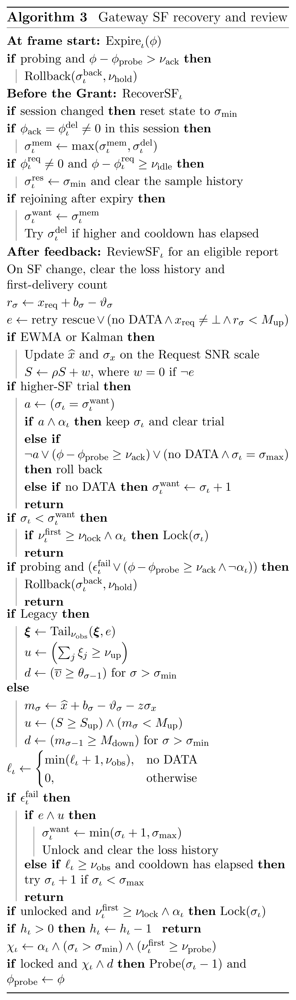

# Protocol and equations

[Home](../../README.md) · [Setup and field test](BENCH_RUNBOOK.md) · [Results](PROGRESS.md) · [简体中文](../zh-CN/SCHEDULED_LINK.md)

## Wire format


Protocol 5 uses little-endian fields in a 28-byte header and a 96-byte
maximum frame. The header carries the network, source, destination,
sender boot ID, frame ID, sequence and schedule version. The Gateway
sends control frames to the group. Requests and DATA go to the Gateway.

| Frame | Sender | Body after the header |
|---|---|---|
| Beacon | Gateway | Period in µs (u32), roster count (u8), then node ID (u16) and byte limit (u8) per Client |
| Request | Client | Gateway boot ID (u32), requested bytes (u8), last ACKed frame in this session (u32, zero if absent) |
| Grant | Gateway | Count (u8), then granted bytes (u8), Client boot ID (u32) and DATA SF (u8) per entry |
| DATA | Client | Gateway boot ID (u32), then the granted application bytes |
| ACK bitmap | Gateway | Count, accepted mask and retry mask (u8 each), then one u32 Client boot ID per position. Unaccepted entries carry zero. |

Empty Grant entries carry length `0xFF` and zero boot ID and SF. The
codec checks length, wire version, network, destination, and payload
shape. The runtime also checks the current frame, the expected session
IDs, the Grant and the receive window. Control uses a shared SF. DATA
uses the granted SF for both its first transmission and retries. Upgrade
the Gateway and every Client together. An older adaptive decoder rejects
an entire Grant containing SF10, so the version byte prevents mixed
deployments from joining the same schedule.

## Airtime and slot budget

$\lambda$ counts all bytes presented to the LoRa modem before its PHY
header and CRC. $\sigma$ is the spreading factor and $\beta$ is the channel
bandwidth in Hz. The following symbol count includes the modulation
overhead and coding groups. [Semtech LoRa Calculator](https://www.semtech.com/design-support/lora-calculator)

```math
\begin{aligned}
\tau_{\mathrm{sym}}(\sigma)&=\frac{2^\sigma}{\beta},\\
\nu_{\mathrm{coded}}(\lambda,\sigma)
  &=\max\!\left(0,\left\lceil
     \frac{\kappa\lambda-\alpha\sigma+\zeta_0+
        \zeta_{\mathrm{CRC}}\iota_{\mathrm{CRC}}-
        \zeta_{\mathrm{IH}}\iota_{\mathrm{IH}}}
      {\alpha(\sigma-\mu\iota_{\mathrm{DE}})}
     \right\rceil\right).
\end{aligned}
```

```math
\begin{aligned}
\nu_{\mathrm{sym}}(\lambda,\sigma)
  &= \pi+\psi+\xi+\gamma\nu_{\mathrm{coded}}(\lambda,\sigma),\\
\tau_{\mathrm{air}}(\lambda,\sigma)
  &= \nu_{\mathrm{sym}}(\lambda,\sigma)\,\tau_{\mathrm{sym}}(\sigma).
\end{aligned}
```

| Symbol | Meaning | Current profile or formula coefficient |
|---|---|---|
| $\kappa$, $\alpha$, $\mu$ | Bits per byte, SF coefficient, LDRO denominator penalty | 8, 4, 2 |
| $\zeta_0$, $\zeta_{\mathrm{CRC}}$, $\zeta_{\mathrm{IH}}$ | Baseline, CRC and implicit-header terms in the symbol numerator | 28, 16, 20 |
| $\iota_{\mathrm{CRC}}$, $\iota_{\mathrm{IH}}$, $\iota_{\mathrm{DE}}$ | Flags for PHY CRC, implicit header and low-data-rate optimization | 1, 0, 0 for this SF range |
| $\pi$, $\psi$, $\xi$ | Programmed preamble symbols, fixed synchronization suffix, baseline payload symbols | 8, 4.25, 8 |
| $\gamma$ | Symbols per coding group, the denominator of the LoRa coding rate | 5 for CR 4/5 |
| $\beta$, $\sigma_{\mathrm{ctrl}}$, $\sigma_\iota$ | Bandwidth, common control SF, per-Client DATA SF | 125 kHz, SF9, SF7–SF10 |

$\Omega$ is the advertised roster and $\nu_\Omega=|\Omega|$ includes idle
Clients with Request windows. Use $\Theta=\Omega$ and each payload ceiling
$\lambda_\iota$ when reserving airtime. For the active schedule, $\Theta$
contains only granted Clients and $\lambda_\iota$ is the granted length.
$\Theta^\star$ contains up to $\varkappa$ of the longest slots in $\Theta$.

```math
\begin{aligned}
\eta &= \eta_{\mathrm{header}}+\eta_{\mathrm{session}},\\
\tau_{\mathrm{slot},\iota}
   &=\tau_{\mathrm{air}}(\lambda_\iota+\eta,\sigma_\iota)+\delta,\\
\tau_{\mathrm{data}}&=\sum_{\iota\in\Theta}\tau_{\mathrm{slot},\iota},\\
\tau_{\mathrm{retry}}&=\sum_{\iota\in\Theta^\star}\tau_{\mathrm{slot},\iota}.
\end{aligned}
```

```math
\begin{aligned}
\tau_{\mathrm{requests}} &= \delta+\nu_\Omega(\tau_{\mathrm{R}}+\delta)+\delta,\\
\tau_{\mathrm{bitmaps}} &= (\varrho+1)\tau_{\mathrm{A}} + \delta_{\mathrm{first}}
    +\varrho(\delta_{\mathrm{before}}+\delta_{\mathrm{after}})\\
    &\quad+\delta_{\mathrm{last}}+\delta_{\mathrm{close}},\\
\tau_{\mathrm{ctrl}} &= \tau_{\mathrm{B}}+\tau_{\mathrm{requests}}
    +\tau_{\mathrm{G}}+\tau_{\mathrm{bitmaps}}.
\end{aligned}
```

```math
\tau_{\mathrm{ctrl}}+\tau_{\mathrm{data}}+
\varrho\,\tau_{\mathrm{retry}}+\tau_{\mathrm{tail}}
\le \tau_{\mathrm{frame}}.
```

$\tau_{\mathrm{B}}$, $\tau_{\mathrm{R}}$, $\tau_{\mathrm{G}}$ and
$\tau_{\mathrm{A}}$ are the airtimes of one Beacon, Request, Grant and
bitmap at $\sigma_{\mathrm{ctrl}}$. Their encoded lengths come from the
wire table plus the common header. $\tau_{\mathrm{requests}}$ includes
the Request windows and the gaps before those windows and the Grant.
$\tau_{\mathrm{bitmaps}}$ covers all feedback frames, the gap before the
first DATA round, the gaps around the retry rounds, the gap before
the final bitmap and the closing guard. Each of these gaps uses $\delta$.
The Gateway uses the inequality before accepting a higher-SF
reservation. Lower-SF trials retain the previous reservation.

| Symbol | Meaning | Current adaptive image |
|---|---|---|
| $\eta_{\mathrm{header}}$, $\eta_{\mathrm{session}}$ | Frame header and Gateway boot ID in DATA | 28 B, 4 B |
| $\nu_\Omega$, $\lambda_\iota$ | Bench roster and per-Client payload ceiling | 8 Clients, 32 B. The wire format allows 64 B. |
| $\varrho$, $\varkappa$ | Retry rounds and shared retry slots per round | 3 rounds, up to 4 slots |
| $\delta$, $\tau_{\mathrm{tail}}$, $\tau_{\mathrm{frame}}$ | Slot guard, end reserve, superframe period | 80 ms, 300 ms, 15 s |

The retune lead and transmit launch window are one quarter of the guard.
The receive window is half a guard on either side of the expected packet
completion. The implementation measures from packet-completion
timestamps. It skips a transmit slot if software reaches it too late.
Physical retune time and drift still need measurement.
[Radio settings](../../include/radio_config.h) ·
[Airtime and sizes](../../src/common/protocol/multiclient_protocol.h) ·
[Slot scheduling](../../src/common/protocol/multiclient_protocol.cpp)

### Capacity at 15 seconds

For equal payload ceilings $\lambda_\mathrm{cap}$, place $\nu'$ Clients at
SF9 and the rest at SF7. The maximum number of SF9 reservations is

```math
\nu_9^{\max}=\max\!\left\{\nu'\in\{0,\ldots,\nu_\Omega\}\;\middle|\;
\tau_{\mathrm{used}}(\Omega,\lambda_{\mathrm{cap}},\boldsymbol{\sigma}(\nu'))
\le\tau_{\mathrm{frame}}\right\}.
```

| Clients | 16 B | 24 B | 32 B | 64 B |
|---:|---:|---:|---:|---:|
| 4 | 4 | 4 | 4 | 4 |
| 6 | 6 | 6 | 6 | 3 |
| 8 | 8 | 8 | 5 | 2 |

The adaptive sample carries 32 B of ASCII (256 bits). With the 28 B frame
header and 4 B Gateway boot ID, DATA is 64 B before LoRa PHY overhead.
Five SF9 Clients and three SF7 Clients reserve 14.905952 s. Eight at SF9
would need 15.722336 s. With all eight requesting, Beacon, Grant and four
ACKs account for 2.361344 s of Gateway transmission. Requests and control
gaps bring the control portion to 6.019456 s. These are computed durations.
[Bench ceiling](../../include/research_roster.h) · [Capacity model](../../tools/model_multiclient.py)

For a fixed roster, both the sum of DATA slots and the sum of the longest
retry slots are nondecreasing in each slot length. A Grant uses at most
the reserved payload and SF per Client, so its modeled time is bounded by
the checked roster reservation. Physical turnaround and clock error still
have to fit the guards.

### SF10 capacity and higher SF options

Eight Clients, 32 B each, SF9 control, four cumulative ACKs
and the full retry reservation. The second numeric column puts one Client at
the listed SF with seven at SF7. The last column gives the maximum number at
that SF when every other Client uses SF7. Times are modeled seconds.

| DATA SF | One 64 B DATA packet (s) | Frame headroom with one (s) | Maximum at this SF |
|---|---:|---:|---:|
| SF7 | 0.118 | 4.720 | 8 |
| SF8 | 0.216 | 4.330 | 8 |
| SF9 | 0.390 | 3.632 | 5 |
| SF10 | 0.698 | 2.399 | 2 |
| SF11 | 1.561 | -1.050 | 0 |
| SF12 | 2.793 | -5.982 | 0 |

With six peers at SF7, two SF10 reservations leave 77.408 ms beyond the
end reserve. A third SF10 exceeds the frame by 2.244 s. The Gateway
checks the current SF reservations and rejects increases that exceed the budget.

The radio sends Beacon, Request, Grant and ACK bitmaps at SF9. Both ends
retune to the granted SF for a DATA slot. The Client returns to SF9 for
feedback and the Gateway uses each next Client's SF before returning to
SF9. If control reception is lost, the Client waits for a new valid Beacon
and Grant. A higher DATA SF extends only the DATA link.

SF10 gives 8.192 ms per symbol at BW125 and uses no LDRO. Even a 96 B
packet at SF10 takes 0.985088 s, within the 2 s driver deadline. SF11 and
SF12 are model-only rows. They need LDRO, and the 96 B SF11 packet and the
64 B SF12 packet each exceed the current TX deadline.
[RadioLib SF limits](https://github.com/jgromes/RadioLib/blob/7.8.1/src/modules/SX126x/SX126x_config.cpp) ·
[RadioLib LDRO selection](https://github.com/jgromes/RadioLib/blob/7.8.1/src/modules/SX126x/SX126x_commands.cpp)

## Adaptation and recovery

The figure and loss window below describe the default `LEGACY` rule.



In the README algorithms, $\phi$ is the frame ID, $\phi_{\mathrm{ack}}$ is
the last ACKed frame in the same Gateway session, and $\Gamma$ is a valid
Grant. Round $\jmath=0$ is the first DATA attempt. $\Theta_\jmath$ is the set
of authorized Clients, $\Xi$ accumulates accepted Clients, and $\Pi_\jmath$
selects up to $\varkappa$ granted Clients whose DATA has yet to arrive.
$\epsilon_\jmath$ records the local Client's permission to send. An invalid
or absent bitmap provides empty sets. The Gateway checks frame and session
identity, declared payload length, and timing before accepting DATA.

For current time $\tau$, scheduled TX start $\tau_{\iota,\jmath}$, expected
packet completion $\widehat{\tau}$ and observed completion $\tau_{\mathrm{rx}}$,
the windows and the SNR update are

```math
\begin{aligned}
0 &\le \tau-\tau_{\iota,\jmath}<\delta_{\mathrm{tx}},\\
-\delta_{\mathrm{rx}} &\le \tau_{\mathrm{rx}}-\widehat{\tau}<\delta_{\mathrm{rx}},\\
\overline{\upsilon}_\iota^{\mathrm{next}}
   &=(1-\omega)\overline{\upsilon}_\iota+\omega\upsilon_\iota.
\end{aligned}
```

This profile uses $\delta_{\mathrm{tx}}=\delta/4$, $\delta_{\mathrm{rx}}=\delta/2$
and $\omega=1/4$. The first finite first-attempt SNR sample $\upsilon_\iota$
at the current SF initializes the filter. The reserved SF can stay above
the requested SF during a lower-SF trial, preserving room to roll back.

The SF policy uses the following quantities. Frame IDs and ACK receipts
refer to the active Gateway session.

| Symbol | Meaning | Current value |
|---|---|---:|
| $\nu_{\mathrm{obs}}$, $\nu_{\mathrm{up}}$ | Size of the eligible-report window and misses needed to request an increase | 3, 2 |
| $\nu_{\mathrm{idle}}$ | Frame-ID gap that frees a higher-SF reservation | 4 |
| $\nu_{\mathrm{lock}}$, $\nu_{\mathrm{probe}}$ | First-attempt deliveries required to lock or consider a lower SF | 3, 6 |
| $\nu_{\mathrm{ack}}$, $\nu_{\mathrm{hold}}$ | Lower trial's receipt limit and first-attempt deliveries in the rollback hold | 6, 8 |

$\epsilon_\iota^{\mathrm{fail}}$ marks a missed first attempt, including a
retry that eventually delivered. $\alpha_\iota$ means the latest Request
echoes the stored delivery's frame and confirms its SF.
$\nu_\iota^{\mathrm{first}}$ counts the current run of first-attempt
deliveries, including the current eligible report. $\phi_\iota^{\mathrm{req}}$
and $\phi_\iota^{\mathrm{del}}$ are the last Request and delivery.
$\sigma_\iota^{\mathrm{del}}$ is the SF used for that delivery. The SF
state carries desired, reserved, remembered and rollback values
$\sigma_\iota^{\mathrm{want}}$, $\sigma_\iota^{\mathrm{res}}$,
$\sigma_\iota^{\mathrm{mem}}$ and $\sigma_\iota^{\mathrm{back}}$.
$h_\iota$ counts the remaining hold after rollback. $\theta_{\sigma_\iota-1}$
is the SNR threshold for trying the next lower SF.

```math
\boldsymbol{\xi}^{\mathrm{loss}}_\iota\gets
  \operatorname{Tail}_{\nu_{\mathrm{obs}}}
  \bigl(\boldsymbol{\xi}^{\mathrm{loss}}_\iota\mathbin{\|}\epsilon_\iota^{\mathrm{fail}}\bigr),
\qquad
\sum_{j}\xi^{\mathrm{loss}}_{\iota,j}\ge\nu_{\mathrm{up}}.
```

The Gateway evaluates the loss test after a miss. The window contains
only eligible reports at the current SF and excludes timing faults and
application refusals. When the count reaches two, the Gateway clears the
window and checks the higher reservation at the next Grant.

A lock requires three first-slot deliveries and an ACK receipt at the same
SF, including when the budget limits a Grant to a lower SF. It stores the
confirmed SF and releases any higher reservation held for rollback. After
lock and hold expiry, six first-slot deliveries and enough filtered SNR
can open a lower-SF trial
(at least −3.5 dB for SF7, −6 dB for SF8 or −8.5 dB for SF9). A degraded
trial rolls back. It also rolls back after six eligible first-slot
deliveries without a matching Client ACK receipt for that SF. Either
rollback delays the next lower-SF trial for eight first-slot deliveries.

A Client retries only when a valid bitmap grants a retry. The Gateway
opens those slots after an in-window TX completion serviced before the
next DATA round. Later cumulative feedback can acknowledge an earlier
delivery after an ACK loss. All four bitmaps are retained. A local timing
fault is reported in the frame sample and excluded from SF review. For
each assigned slot, the Gateway checks for RX armed at the assigned SF
during the retune lead or a valid DATA reception. Without either observation
it skips SF review for that Client in this frame. If the Beacon expires,
the Client stops scheduled TX and searches on the control SF. The
Gateway releases the inactive Client's higher-SF reservation at a Grant
prepared at least four frame IDs after its previous Request. When the
same Client boot returns, the Gateway proposes the SF it remembered from
a matching ACK receipt or later lock. The Gateway checks the new Grant
against the current budget, so a returning Client may receive a lower SF. A lower-SF
trial only lowers the remembered SF once it locks. A new Client boot ID
or Gateway session clears the hint.
Synchronous radio dependencies can still overrun
software windows. [LaTeX source](../research/figures/adaptive-algorithm.tex) · [Runtime](../../src/app/multiclient_link.cpp) · [Known timing risks](ERROR_LOG.md)

### Loss-cause-aware ADR

The Gateway offers three build-time rules. `LEGACY` is the default.
`MARGIN_EWMA` tracks an exponential mean and variance. `MARGIN_KALMAN`
tracks level and slope and projects both the level and its uncertainty one
eligible report ahead. With no SNR in an eligible report, EWMA holds its
estimate and Kalman predicts without a measurement update.

The Gateway prefers the SNR from a validated SF9 Request and falls back to
accepted DATA SNR. A per-SF offset in [AdrParams](../../src/app/adr_policy.h)
models DATA SNR minus Request SNR. It starts at zero. The estimator uses a
common Request-SNR scale across SF changes and starts fresh for a new session
or after idle state expires. Log both measurements to estimate the offset.

| Quantity | Initial experimental setting |
|---|---|
| Provisional SNR threshold $\vartheta_\sigma$ at SF7/8/9/10 | −7.5 / −10 / −12.5 / −15 dB. Replace with measured SNR at 50% delivery for each SF. |
| Margin $m_\sigma=\widehat{x}+b_\sigma-\vartheta_\sigma-z\sigma_x$ | Forecast SNR $\widehat{x}$, offset $b_\sigma$, and forecast standard deviation $\sigma_x$ with $z=1$ |
| Evidence $S$ | Decay by 0.75 per eligible report. Add 1.0 after complete loss, 0.4 after a same-SF retry delivers, or 0 after a first-attempt delivery. |
| Raise DATA SF | $S\geq1.5$ and $m_\sigma<0$ dB. Four consecutive eligible reports with complete loss override the margin. |
| Try lower DATA SF | Existing lock and receipt rules, six first-attempt deliveries, and $m_{\sigma-1}\geq4$ dB. Preserve rollback, hold, and receipt expiry. |
| Estimators | EWMA weight 0.25. Kalman level and slope process variances 0.16 and 0.01, measurement variance 1.0, initial slope variance 0.25. Units use one step per eligible report. |

`V3_LINK_SAMPLE` keeps the fields used by older captures. Adaptive Gateway
rows add `node_id`, `class`, `snr_req`, `snr_data`, `level`, `slope`,
`sigma`, `margin`, `score`, `decision`, `rule` and `params_version`.
The margin describes the granted SF. The score for an increase is logged
before clearing its evidence. Missing values appear as `N/A`.
`LOST_ALL` means that no granted opportunity delivered DATA.
`ABSENT` means the Gateway saw no valid Request during an observed request
phase. `EXCLUDED` covers local timing faults or application refusal.
Neither class changes the estimator or score. The other classes are
`OK_FIRST` and `RESCUED_SAME_SF`. The offline parser skips invalid timing,
application refusal and absence, and still accepts older captures.

Every increase still passes the original full-roster airtime check.
High-margin losses suggest an SF-independent cause, but a single Gateway
cannot identify the interferer from these observations. A network-wide
loss mask is deferred until measurements separate shared interference
from several Clients fading at once. The [seeded simulator](../../tools/adr_sim.py)
compares the rules under an assumed channel model.

## Board reference

Heltec V3.4 uses ESP32-S3, SX1262 and CP2102 UART0. Use the V3.2 electrical
reference when checking the board. Radio GPIOs 8–14 are NSS, SCK, MOSI,
MISO, reset, BUSY and DIO1. DIO2 controls the RF switch and DIO3 powers
the 1.8 V TCXO. The display uses SDA 17, SCL 18, reset 21 and active-low
Vext 36. The research profile uses provisional 915.0 MHz and requests
22 dBm with 140 mA PA overcurrent protection.
Verify actual power and RF variant before a field run.
[Board pins](../../include/board_pins.h) ·
[Heltec schematic](https://s.heltec.cn/download/WiFi_LoRa_32_V3/WiFi_LoRa_32_V3.2_Schematic_Diagram.pdf)
