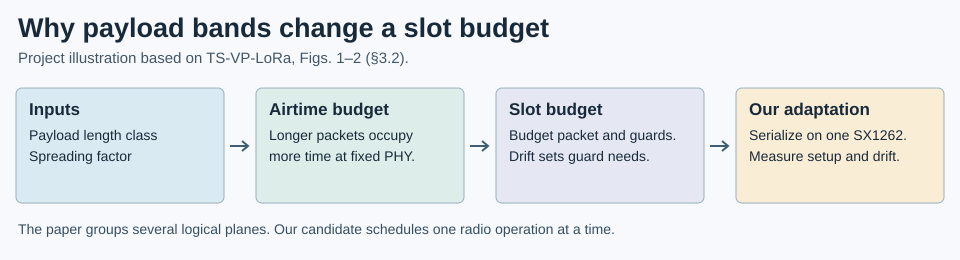
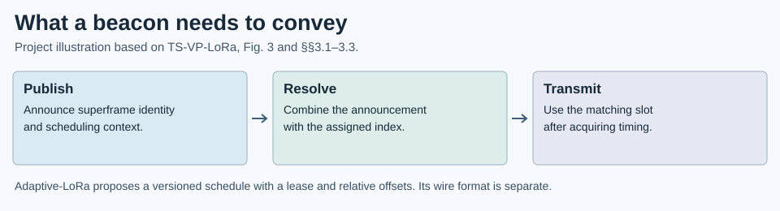
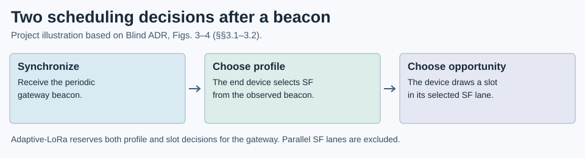
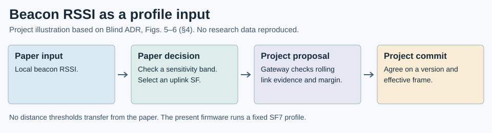
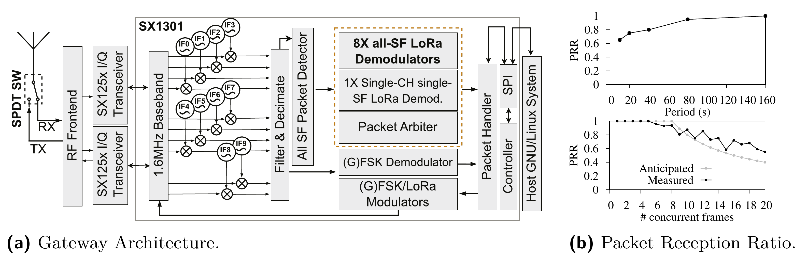
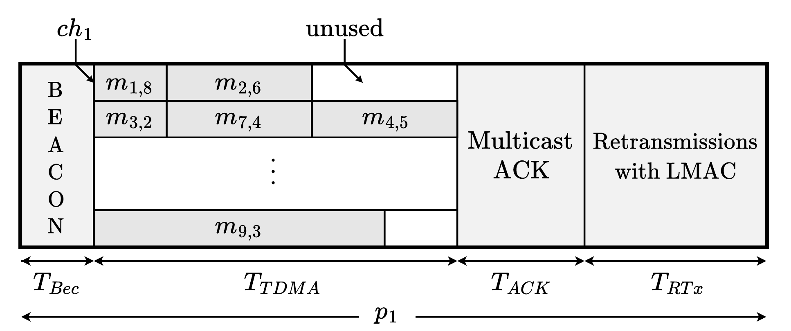
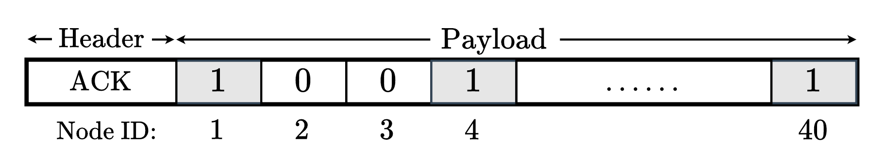
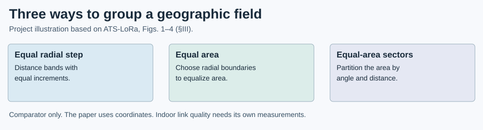
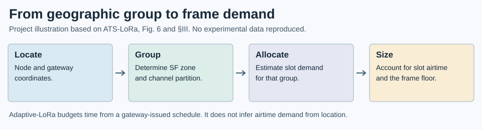

# Adaptive-LoRa research references

The four references below inform the project’s planned gateway-scheduled TDMA,
conservative ADR, ACK bitmap and selective retransmission. Each description
separates the paper’s mechanism from the project’s adaptation. The production
firmware currently exchanges fixed-PHY M2 HELLO and unicast ACK frames. The
[traceability matrix](../research/ALGORITHM_TRACEABILITY.md) maps the proposals
to the code and tests that exist today.

The [figure source register](FIGURE_SOURCE_REGISTER.md) gives the exact
captions, page indices, printed pages, licenses and asset provenance. The
source PDFs remain local in `paper-references/`.

## R1 · TS-VP-LoRa

A. Triantafyllou, D. Zorbas, and P. Sarigiannidis, “Time-slotted LoRa MAC
with variable payload support,” *Computer Communications*, vol. 193,
pp. 146–154, 2022. [DOI 10.1016/j.comcom.2022.06.043](https://doi.org/10.1016/j.comcom.2022.06.043)

The paper aims to accommodate variable payloads efficiently in scheduled
LoRa access. A network server assigns a timeslot index. The gateway advertises
the superframe, and the node uses its index in the plane for its spreading
factor and payload range. Slot length includes two guard intervals. The
channel-hopping rule distributes payload ranges across the available channels.
Figures 1–3 cover the superframe collection, one superframe and beacon fields.

Both SVGs are project illustrations based on R1 §§3.1–3.3. Adaptive-LoRa
adopts beacon-referenced scheduling and budgets time for the payload and
guard. The proposed gateway serializes radio operations on one SX1262.
Parallel payload/SF planes and channel hopping are excluded from that design.
R1 evaluates its scheme in simulation and its comparison does not schedule
data ACKs. Beacon and slot scheduling in Adaptive-LoRa are **Planned**.

## R2 · Blind ADR with distributed TDMA

H. Soy, “An adaptive spreading factor allocation scheme for mobile LoRa
networks: Blind ADR with distributed TDMA scheduling,” *Simulation
Modelling Practice and Theory*, vol. 125, Art. no. 102755, 2023.
[DOI 10.1016/j.simpat.2023.102755](https://doi.org/10.1016/j.simpat.2023.102755)

The objective is to adapt spreading factor as link conditions change for
mobile nodes. Devices synchronize from a beacon, choose uplink SF from
their own beacon RSSI and randomly choose a slot in the associated subframe.
The system model assumes an SX1301 multichannel gateway and makes use of
concurrent SF reception. Figures 3–4 show the topology and frame, and
Figures 5–6 show modeled RSSI and SF variation with distance.

Both SVGs are project illustrations based on R2 §§3–4. Adaptive-LoRa uses
RSSI as one input to a future gateway decision, alongside SNR and delivery
evidence. It proposes a versioned profile change with a common control
PHY and experimental thresholds. Independent node SF selection, published
distance thresholds and randomized slots are **Not adopted**. Conservative
ADR is **Planned**. The displayed diagrams contain no paper measurements.

## R3 · LoRaHART

S. R. Sahoo, A. Gamage, N. Kumar, and A. Easwaran, “LoRaHART:
Hardware-Aware Real-Time Scheduling for LoRa,” in *37th Euromicro
Conference on Real-Time Systems (ECRTS)*, LIPIcs, vol. 335, Art. no. 10,
pp. 10:1–10:28, 2025.
[DOI 10.4230/LIPIcs.ECRTS.2025.10](https://doi.org/10.4230/LIPIcs.ECRTS.2025.10)

LoRaHART targets predictable uplink delivery under the receive concurrency
and half-duplex constraints of commercial LoRa gateways. Its SX1301-based
design separates beacon synchronization, TDMA uplinks, a multicast ACK and
a contention-based retry segment. The ACK conveys reception outcomes in a
bit vector. Its retransmissions use LMAC and recover missed packets within
the same superframe.

Figure 1, printed p. 10:6. Panel (a) shows the concentrator and antenna switch.
Panel (b) contains **the paper’s** packet reception plots.

Figure 2, printed p. 10:9. The beacon aligns clocks, the gateway receives during
TDMA, then transmits the aggregate ACK before an LMAC retransmission phase.

Figure 3, printed p. 10:10. A bit records the outcome for a node. Adaptive-LoRa
binds bits to a versioned schedule order, and reserves deterministic retry
opportunities for missing or unknown outcomes. It has one SX1262, so it uses
serialized uplinks and profile transitions. LoRaHART’s concentrator packing and
opportunistic CSMA are **Not adopted**. The bitmap and deterministic selective
retry are **Planned**.

Figures 1–3 are raster crops of the original diagrams, with page margins and
captions removed. © S. R. Sahoo, A. Gamage, N. Kumar and A. Easwaran, ECRTS
2025. [Publisher record](https://drops.dagstuhl.de/entities/document/10.4230/LIPIcs.ECRTS.2025.10)
· [CC BY 4.0](https://creativecommons.org/licenses/by/4.0/).

## R4 · ATS-LoRa

H. Alahmadi, F. Bouabdallah, A. Al-Dubai, and B. Ghaleb, “A Novel
Autonomous Adaptive Frame Size for Time-Slotted LoRa MAC Protocol,”
*IEEE Transactions on Industrial Informatics*, vol. 20, no. 10,
pp. 12284–12293, Oct. 2024.
[DOI 10.1109/TII.2024.3417308](https://doi.org/10.1109/TII.2024.3417308)

The paper targets scalable access with autonomous allocation and sized
frames. It uses node and gateway coordinates to assign an SF corona, then
partitions that region by radius, area or angle to allocate channel and
slot opportunities. Estimated demand and airtime affect the frame size.
Figures 1–4 show the allocation geometry. Figure 6 compares frame sizes
for the proposed modes and the paper’s baseline.

Both SVGs are project illustrations based on R4 §III and Fig. 6. For
Adaptive-LoRa the paper is a **comparator** for frame budgeting. Geographic
SF zoning, autonomous channel/slot assignment and use of a simulator’s
frame-size results as factory sizing evidence are **Not adopted**.

## Hardware specifications

- [Semtech SX1262 product and datasheet](https://www.semtech.com/products/wireless-rf/lora-connect/sx1262)
  provides the transceiver constraints.
- [Heltec WiFi LoRa 32 V3](https://heltec.org/project/wifi-lora-32-v3/)
  and the [project hardware record](../en/HARDWARE.md) provide the board
  reference and separate bench evidence.
