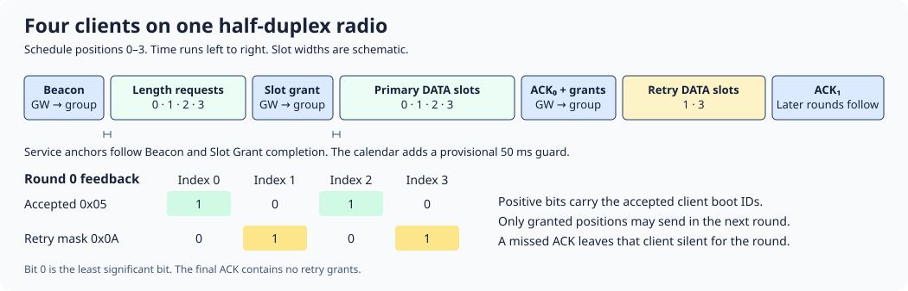

# Research-to-code traceability

## Iteration 021: one Gateway and eight Clients

The selected source sections describe different gateway capabilities.
The table records the mechanisms carried into this single-SX1262 design
and the evidence collected for each.

| Reference | Mechanism in the project | Evidence and limit |
|---|---|---|
| R1, TS-VP-LoRa §§3.1–3.3 | Beacon and grant completion timestamps anchor serial slots. Request length determines DATA airtime. | The runtime tests introduce a 30 ms service delay after an on-time radio event. Actual timestamp and turnaround error still need measurement. Parallel SF planes and channel hopping require a different receiver/calendar. |
| R2, Soy §§3–4 | Obtain per-client link evidence and vary candidate SF in an offline evaluation. Our evidence comes from Gateway uplinks and explicitly distinguishes first delivery, retry and no valid DATA. | The analyzer tests independent sessions and configurable hysteresis. This is a different measurement direction from Soy's node-local downlink RSSI decision. Single-radio retuning still needs a versioned agreement, coordinated airtime and a recovery profile. |
| R3, LoRaHART §§3, 5–6 | Serialize Gateway RX and bitmap TX. Pack four shared retry slots per retry phase. | The test network exercises all eight 64-byte clients and checks that grants, DATA, feedback and retry traffic never overlap. Concentrator packing and LMAC are outside the current MAC. |
| R4, ATS-LoRa §III | Derive a worst-case period from the roster, then form the active DATA calendar from exact-length grants. | The eight-client reservation model and host cases bound current software admission. The geographical allocation and adaptive frame size of ATS-LoRa remain comparison points. |

The next experiment measures control and data completion, TX preparation,
RX re-arm and drift with one Gateway and eight Clients. Compare first-pass
delivery, total delivery after retries, ACK agreement, airtime and timing
misses before assigning retune costs or choosing ADR thresholds.

## Iteration 020 multi-client firmware

| Research source | Adaptation | Implementation and host verification |
|---|---|---|
| R1, TS-VP-LoRa §§3.1–3.3 and Figs. 1–3. Beacon-based synchronization and airtime slots for different payload sizes. | Gateway announces a roster, collects actual byte counts, then grants sequential slots on one fixed SF7 channel. The beacon and grant establish local completion anchors. | [`MulticlientLink::gatewayRequest` and `client`](../../src/app/multiclient_link.cpp), [`Plan::dataStart`](../../src/common/protocol/multiclient_protocol.cpp). The 1/2/4/8-client suite compares production DATA slots, mixed payloads, frame expiry and application bytes using a fake half-duplex radio. |
| R3, LoRaHART §§3, 5–6 and Figs. 1–3. Half-duplex scheduling and acknowledgment by position. | Each bitmap contains cumulative acceptance and the next retry grants. Missing clients share four reserved slots. Unknown feedback keeps a client silent for that round. The firmware retains accepted identity and bytes per roster position. | [`MulticlientLink::gatewayData` and `acceptFeedback`](../../src/app/multiclient_link.cpp). Native tests exercise rotating partial grants, all-loss exhaustion, byte-identical retry, cumulative recovery, duplicate and conflicting DATA, and wrong ACK identity. |
| R4, ATS-LoRa §III and Fig. 6. Frame reservation and efficiency vary with assigned load. | Derive the configured roster's period from its worst-case payload budget. Use actual requested bytes to size the active calendar and reject oversubscribed schedules. No geographical zoning. | [`requiredPeriodUs` and `reservationUs`](../../src/common/protocol/multiclient_protocol.cpp), [capacity model](../../tools/model_multiclient.py). Native boundary checks and a matching analytical 8-client budget accompany 63 host scenarios through 70 logical clients. |
| R2, Soy §§3–4 and Figs. 4–6. Link-quality inference from beacon RSSI. | Retain RSSI/SNR observations for future gateway decisions with minimum observation windows and hysteresis. v3 has no dynamic SF or retune policy. | [`RadioDriver::poll`](../../src/common/radio/radio_driver.cpp) supplies RX metrics. The PHY checks lock active SF to 7. A versioned agreement, fallback and an on-board retune budget remain prerequisites. |

The [`PayloadPort`](../../src/app/payload_port.h) copies application bytes
into a single pending buffer and exposes a synchronous receive callback.
The separate [runtime tests](../../test/test_multiclient_runtime/test_main.cpp)
verify that arbitrary bytes reach the real `RadioDriver` path and the stock
gateway callback. See the [current results](../en/PROGRESS.md) and
[wire, timing and capacity details](../en/SCHEDULED_LINK.md).

## Iteration 019 single-client reference

The [four references](../references/README.md) and [figure register](../references/FIGURE_SOURCE_REGISTER.md)
identify the papers, figures and rights. The [v2 wire and timing specification](../en/SCHEDULED_LINK.md)
defines the legacy single-client research profile. The default firmware uses the v1
HELLO/ACK path. The [airtime feasibility study](../en/TDMA_FEASIBILITY.md)
is an earlier analytical comparator.

| Paper and mechanism | Adaptation in Adaptive-LoRa | Source and host evidence |
|---|---|---|
| R1, TS-VP-LoRa, §§3.1–3.3, Figs. 1–3, pp. 148–150. The network server schedules payload/SF groups and the gateway advertises frame timing. Packet airtime and guards determine slot length. | The gateway grants index 0 to client 2. The two roles anchor locally at serviced beacon completion and derive one serialized SF7 calendar from the payload budget. The client skips a missed beacon or expired launch window. Parallel SF planes and channel hopping were excluded. | [`ScheduledLink::gateway`, `acceptBeacon` and `client`](../../src/app/scheduled_link.cpp); [`Schedule` and `airtimeUs`](../../src/common/protocol/scheduled_protocol.h). Tests include `timing_and_payload_bounds`, `happy_path_stays_inside_slot_and_repeats`, `invalid_beacon_and_missing_beacon_suppress_transmit`, and `stale_beacon_cannot_rearm_and_expired_launch_is_skipped`. |
| R3, LoRaHART, §§3, 5–6, Figs. 1–3, pp. 10:6, 10:9–10:10. Beacon, uplink, multicast bitmap and retransmission are timed around the gateway’s radio use. Node position in the bit vector records reception. | One SX1262 serializes uplink and feedback. The bitmap position is the schedule index. The feedback binds to network, gateway boot, frame, schedule, round and accepted client boot/sequence. A zero bit and an expired feedback window have separate results. The initial transmission and three retry opportunities reuse the same DATA bytes. The gateway accepts once per frame and re-acks a duplicate. SX1301 concurrency, high-SF multicast and opportunistic CSMA were excluded. | [`ScheduledLink::gateway` and `client`](../../src/app/scheduled_link.cpp); [`validBitmap`, `encode`, `decode`](../../src/common/protocol/scheduled_protocol.cpp). Tests cover lost DATA, lost ACK, duplicate DATA, wrong identities, retry exhaustion and bitmap padding for 1/10/70 positions. Only the single-client wire format runs end to end. |
| R2, Soy, §§3–4, Figs. 4–6. Nodes estimate link conditions from beacon RSSI and select SF locally with distributed slot choices. | The gateway remains the future ADR authority. Read RX RSSI/SNR with delivery and retry history, apply hysteresis over a minimum observation window, and activate versioned changes at an agreed frame boundary. Node-local SF choice and random slot allocation were excluded. | [`RadioDriver::poll`](../../src/common/radio/radio_driver.cpp) collects metrics. ACK outcome and retry records exist in the scheduled profile. The evaluator, thresholds, hysteresis and PHY commit handshake remain planned. Both profiles run SF7. |
| R4, ATS-LoRa, §III and Fig. 6, p. 12290. The model relates frame size to distribution of nodes among scheduled channel/SF groups. | Compare frame-budget sensitivity to payload sizes and workload. The deployed research profile has a fixed per-configuration period and no geographical assignment. | [`tdma_feasibility.py`](../../tools/tdma_feasibility.py) sizes host-only heterogeneous workloads. [`Schedule::valid`](../../src/common/protocol/scheduled_protocol.h) enforces the distinct v2 calendar budget. No adaptive frame-size controller or location-based allocation is implemented. |

The [scheduled tests](../../test/test_scheduled_link/test_main.cpp) run actual
role code with fake radio and clock inputs. Tests include client/gateway
reboot, rejection of retired sessions, late beacon TX completion, rollover
of the driver's 32-bit timer, and deliberate separation of v1 and v2 frames.
`FirmwareRuntime` selects the v2 role path in the ESP32 research build.
Section timing and equations are in the [v2 specification](../en/SCHEDULED_LINK.md).
The [repository audit](ITERATION_019_AUDIT.md) lists configuration,
compatibility, provenance and verification findings.

Measure radio turnaround, IRQ servicing, oscillator drift, supply headroom
and BUSY/flash blocking before treating the experimental guard as an RF
bound. Future rejoin messages, multi-client mapping, replay hardening and a
general application delivery API require separate acceptance work.
