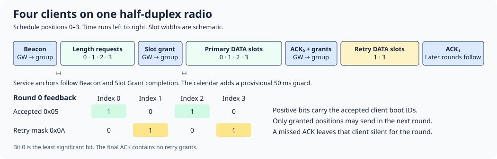

# 定时研究链路

## 自适应协议 v4

实验镜像 `heltec_wifi_lora_32_V3_adaptive` 同时用于 Gateway 和 Client，空口版本为 4。
帧头为 28 字节，整帧上限 96 字节。[帧格式](PROTOCOL.md)列出公共帧头的偏移，
多字节字段用小端序。

| 帧 | SF | 载荷字段顺序 |
|---|---|---|
| Beacon | 9 | 周期 (u32)、节点数 (u8)，再按 Client 列出节点 ID (u16) 和载荷上限 (u8) |
| Request | 9 | Gateway boot ID (u32)、请求长度 (u8)、最近确认的帧号 (u32，未知填 0) |
| Grant | 9 | 节点数 (u8)，每项包含授权长度 (u8)、Client boot ID (u32) 和 DATA SF (u8) |
| DATA | 7–9 | Gateway boot ID (u32) 和授权的应用载荷 |
| ACK 位图 | 9 | 节点数、接收位图和重传位图（各 u8），随后是 Client boot ID (u32) |

Grant 空项长度为 `0xFF`，boot ID 和 SF 为 0。Client 用授权 SF 发送当前帧的 DATA
及重传。帧号与 boot ID 将 Request、Grant 和 DATA 对应起来。缺少有效授权或重传许可时，
Client 留在 SF9 监听。

实验名单支持八个 Client，每个最多 64 字节。15 秒周期采用 80 ms 时隙间隔，提前 20 ms
切换，发射启动窗口为 20 ms，帧尾预留 300 ms。Gateway 按整个名单的载荷上限为已保留的 PHY
计算预算，每轮覆盖空口时间最长的四个共享重传。试用较低 SF 时保留原退回预算。实际时隙仍按
实际字节数安排，较高 SF 只有在预算内才会授权。按八个 Client 各预留 64 字节、其余节点为
SF7 计算，两个 SF9 预留共需 14.157 秒（含帧尾），三个需要 15.634 秒。调整保护间隔前，
先测量两种角色的无线时序。计算公式见 [README](../../README.zh-CN.md#空口时间预算)。

同一 SF 连续两次首轮未收到 DATA 时，在预算内尝试升一级，包括重传收到和完全未收到。
未收到也可能由下行授权丢失造成。检测到本机时序错误或应用拒绝的数据不用于调节。
连续三次首轮交付且有同一 SF 的 Client ACK 回执后标记稳定。连续六次首轮交付且平滑 SNR
有余量时，才试用低一级 SF。
初始试验阈值为 SF7 的 −3.5 dB 和 SF8 的 −6 dB。低一级的试用失败即退回，至少等待八次
首轮交付后再考虑试用。这些阈值基于典型解调门限加余量，仍需校准。
[Semtech TN1300.05](https://www.semtech.com/uploads/technology/LoRa/predicting-lorawan-capacity.pdf)

调整状态只保存在内存。Client boot ID 变化或四帧未收到其请求时清除。信标过期后 Client
返回 SF9 搜索。屏幕显示上次成功确认的 DATA SF。Gateway 的 `locked=1` 表示稳定交付并收到
匹配的 Client ACK 回执。双向事件按[走测流程](BENCH_RUNBOOK.md#自适应-v4-走测)对照。
`ADR_TIMING` 包含从请求切换到主循环观察到 RX 就绪的耗时，含调度抖动。
实物时序上限仍需用 DIO1、NSS 和 BUSY 波形测量。

固定 SF 对照协议

## 多 Client 协议 v3

Gateway 和各 Client 均使用 `heltec_wifi_lora_32_V3_multiclient`，串口 `status`
显示 `profile=multiclient`、`protocol=3`。所有阶段使用 SF7。烧录和角色设置见
[README](../../README.zh-CN.md#烧录与配置)。修改名单 ID 或每个 Client 的字节预算时，
需编辑 [research_roster.h](../../include/research_roster.h) 并重新构建。
遥测和刷新时序见[显示诊断](DISPLAY_DIAGNOSTICS.md)。旧版实验使用下文的 v2 构建环境。

### 线格式

[公共帧头](PROTOCOL.md) 为 28 字节，整帧最多 96 字节。字节 2 为版本 `3`；字节 4、
22–23 和 27 必须为零，调度版本 24–25 为 `1`。boot ID 和 frame ID 均非零。
多字节字段采用小端序。Client 只使用已配置 Gateway 的控制帧。

| 类型 | 目的地址和头部序号 | 自字节 28 起的载荷偏移 |
|---|---|---|
| `0x10` BEACON | 组播 `0xFFFF`，序号 0 | `0..3` 周期（µs），`4` 名单人数（1–8），其后每项为 Node ID（u16）和应用载荷上限（u8，0–64）。 |
| `0x13` PAYLOAD_REQUEST | 单播 Gateway，序号为 frame ID 低 16 位 | `0..3` Gateway boot ID，`4` 实际待发载荷长度。 |
| `0x14` SLOT_GRANT | 组播 `0xFFFF`，序号 0 | `0` 名单人数，其后每项为实际长度（u8）和 Client boot ID（u32）。无请求时长度 `0xFF`、boot ID 为 0。 |
| `0x11` DATA | 单播 Gateway，序号为 frame ID 低 16 位 | `0..3` Gateway boot ID，其余为 0–64 字节应用载荷；帧头标识 Client 及其会话。 |
| `0x12` ACK_BITMAP | 组播 `0xFFFF`，序号为轮次 0–3 | `0` 名单人数，`1` 已接收位图，`2` 下轮重传授权位图，其后每项为 u32 Client boot ID。仅确认位置携带对应 boot ID。 |

名单位置 0 对应最低有效位，未使用位必须为零。已收与重传位图不可重叠。重传只能
授予本帧活动位置，最后一轮的重传位图为零。校验网络、Gateway、Gateway boot ID、
frame ID、调度版本、索引和轮次一致后才处理反馈。v1、v2、v3 各自拒绝其他版本。

### 时序、接纳与重传

Gateway 先公告名单，各节点在独立请求时隙报告实际长度，再按名单顺序得到精确授权。
无请求时不发授权。Beacon 和授权以 DIO1 完成时间作为锚点。仅检测到引脚电平时，
使用轮询入口时间。过期 Beacon、
旧 Gateway 会话或缺少授权时不发送 DATA。

令 `G = 50 ms`（试验值），`T(L)` 为下文 SF7 空口公式。请求时隙为 `T(33) + G`，
载荷 `b` 字节的 DATA 时隙为 `T(32+b) + G`。首轮包含所有有效时隙，随后每轮按活动
节点中最耗时的最多四个时隙预留共享池。请求、授权、DATA 阶段之间和每次 ACK 前后
均留保护时间。发射须在时隙起点后的 `G/4` 内启动，接收完成须落在预计结束时间的
`[-G/2, +G/2)`。发射启动仍使用当前处理时间。Gateway 不启用会延伸至下一 Beacon 的延迟授权。

`include/research_roster.h` 的周期为零时，按名单最大载荷计算并向上取整至毫秒，下限
为目标 **1000 ms**，上限为 **10000 ms**。默认 8 节点、每个 64 字节的名单需要
**6516 ms** 无线预留。v3 屏幕 Gateway 在自动周期且不超过上限时给显示增加
**250 ms**，因此广播 **6766 ms**。上报默认 **3000 ms**，M2 ACK 超时 **1000 ms**，
两者独立于研究周期。
保护时间与实际发射延迟仍需实测。

Client 错过下一次 Beacon 的接收完成窗口后，停止使用过期时隙并保持接收。尚未发送
的载荷保留在队列中，已发送且未能确认结果的载荷标记为 UNKNOWN。保留最近一次
Beacon 的身份，以便检查重放和会话。

位图累计确认已接收 DATA。重传池仅分给欠缺位置，选择起点随帧号和轮次轮转。最多
初发一次加三次重传。重传使用相同的帧字节，资源不足时部分 Client 获得的次数更少。
丢 ACK 后 Client 无法推断新区间，本轮重传保持静默，之后的累计 ACK 仍可确认投递。
Gateway 只有在相应帧和轮次的位图收到 TX_DONE 且下一轮时隙尚未开始时，才启用重传位图。

### 链路自适应实验

最后一轮位图完成后，Gateway 为每个已授权 Client 记录 `V3_LINK_SAMPLE`，包含首轮收到、
重传收到或未收到有效 DATA，以及可用的 RSSI、SNR 和应用接受结果。本机无线错误或
反馈错过期限的帧不计入。未收到 DATA 也可能是 Client 丢失授权，应对照 Client 日志。

执行 `python tools/adr_shadow.py --help` 查看窗口、首轮接收目标、SNR 阈值和滞回参数。
工具按两端启动会话分组，忽略完全重复记录，只用明确采样，给出平均 RSSI，并根据
SNR 和首轮接收率给出实验候选 SF。
变更前须重新校核空口与重传时序。当前空口固定 SF7，启用动态切换须有带版本的
确认流程、共同恢复配置，并实测 SX1262 切换及处理时间。

### 应用载荷与结果

`FirmwareRuntime::submitPayload` 通过 `PayloadPort` 复制 0–64 字节到单条待发队列。
返回入队、忙、长度超限、无效指针或未激活。重传期间内容不变。`payloadResult()` 返回
已接收、明确欠缺、未知或名单拒绝。若请求或授权丢失，尚未发送的载荷等下一帧。
Gateway 同步调用应用回调，字节指针仅在本次调用期间有效。回调同意后才设置正反馈。
同一 Gateway 会话和当前帧内每个身份最多交付一次。示例 Client 通过同一 API 提交
八字节；示例 Gateway 将内容排入串口十六进制日志。没有断电持久队列或远端应用确认。

### 十秒计算容量

SF7、每节点 64 字节、50 ms guard、每轮最多四个共享重传时隙时，1、2、4、8 节点分别
占用 1.990656、2.999696、5.022896、6.515504 秒。10 节点的扩展格式计算为 7.274608 秒，
超过当前八节点实现上限。20 节点需 10.998448 秒且授权帧达 129 字节，超出 96 字节。
70 节点即使省略无法编码的控制帧也至少占 27.020528 秒。8 节点使用 25、75 ms guard
时分别为 5.540504 和 7.490504 秒。63 组参数的复现与假设见
[英文规范](../en/SCHEDULED_LINK.md)。这些结果没有采集实物时序、丢包或容量证据。

## 旧版协议 v2（Iteration 019）

两块板均构建 `heltec_wifi_lora_32_V3_research`，通过 NVS 选择角色。串口
`status` 应显示 `profile=scheduled` 和 `protocol=2`。网络设为 1，Gateway
设为 1，Client 设为 2，两边均执行 `config set hello-interval-ms 10000`，再保存
并按台架流程重启。NVS schema 1 和 115200 波特率串口与 M2 共用。角色、ID
或周期无法容纳调度时，固件进入配置模式并禁用无线。此镜像无 屏幕、无协议协商。
不同版本会共享空口，台架每次只用一种协议。

## 线格式

沿用 [协议](PROTOCOL.md) 的 28 字节头和 96 字节上限。字节 2 为 `2`，字节 4、
22–23、27 为零。网络及目的地址必须匹配，源和目的为不同的单播地址。12–15 字节
发送方 boot ID 和 16–19 字节 Gateway frame ID 均非零。frame ID 在同一 Gateway
会话内递增，重复编号前更新会话。24–25 字节为调度版本 `1`，字节 26 为精确载荷长。
多字节字段使用小端序。

| 字节 3 类型 | 字节 20–21 序号 | 自字节 28 起的载荷偏移 |
|---|---|---|
| `0x10` BEACON | `0` | `0..3` 周期（u32 µs），`4` 应用字节上限（0–64），`5` 总轮数（`4`）。长度 6，目的地址 2 对应调度索引 0。 |
| `0x11` DATA | frame ID 低 16 位 | `0..3` 回显 Gateway boot ID（u32），`4..末尾` 应用载荷（0–64，受时隙授权限制）。长度 4–68，头部 boot ID 标识 Client。 |
| `0x12` ACK_BITMAP | 轮次 `0..3` | `0` Client 数（`1`），`1` 位图字节数（`1`），`2` 索引 0 结果（最低位，其余为零），`3..6` 已收 Client boot ID，`7..8` 已收 DATA 序号。长度 9，位图为零时两个身份字段为零。 |

拒绝其他类型和版本。位图长度和补零检查也覆盖 10、70 个逻辑位置（2、9 字节），
v2 空口帧只允许一个 Client。

## 时序与重传

Gateway 以主循环处理 Beacon TX_DONE 的时间为锚，Client 以处理 RX_DONE 的时间为
锚。Client 校验发送方、周期、递增帧号及调度版本，每帧须收到新的 Beacon。Gateway
会话变化时须等上一 Beacon 的周期加保护时间过期，并拒绝最近退役的会话。历史在
内存中，Client 重启后不保留历史。

SF7/BW125/CR4/5 下，完整帧 `L` 字节的空口时间为
`T(L) = 256 µs × (81 + 20 × ceil((8L + 16) / 28))`。令 `G = 50 ms`、
`D = T(32 + 授权载荷字节数)`、`A = T(37)`。第 `r` 轮上行起点为
`2G + r(D + A + 8G)`，反馈起点再加 `D + 4G`，反馈截止再加 `A + 2G`。
启动窗口为 `[起点, 起点 + G)`。接收完成窗口为
`[起点 + 空口时间 − G, 起点 + 空口时间 + 2G)`。完整轮次、Beacon 空口时间和尾部
余量须放进周期，反馈轮次受旧版 v2 独立的 10 秒上限约束。M2 超时见 [协议](PROTOCOL.md)。

当前授权 8 字节，Client 发送本地 Beacon 观察时间（µs）。Gateway 接收时隙内第一份
有效 DATA，保存其字节和身份。相同重传可再次确认，冲突载荷或身份被拒。匹配的正
反馈结束发送，零位记为 `missing`，等到反馈窗口关闭仍无有效反馈记为 `unknown`。
两种情况均可在指定重传时隙重发原来的字节。初次加三次重传仍无成功则记录
`retry_exhausted`。Gateway 每轮发送累计位图，因为它无法知道 Client 是否收到反馈。

## 尚需实测

实际 `FirmwareRuntime` 通过 `RadioDriver` 运行这套状态机。两种角色使用单无线和
固定 SF7，50 ms 为试验保护时间。实板须量测时钟漂移、IRQ 服务延迟、收发切换及
请求到发射时间。BUSY 和 flash 延迟风险仍存在。当前没有鉴权或持久防重放、多 Client
分配、通用应用交付接口、自动 PHY 切换或 ADR。论文及主机证据见
[追溯矩阵](../research/ALGORITHM_TRACEABILITY.md)。

